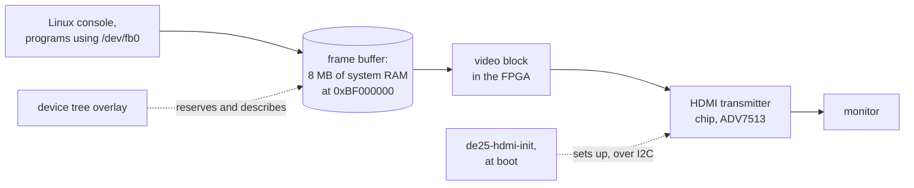
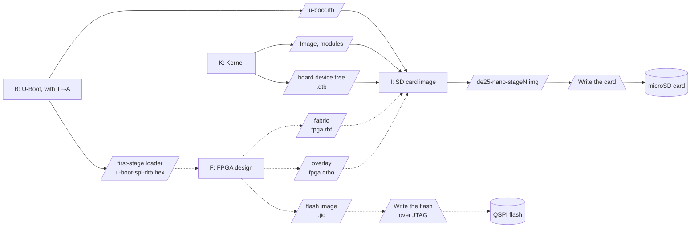

# Debian on the Terasic DE25-Nano

This repository brings up Debian 13 on the [Terasic DE25-Nano](https://www.terasic.com.tw/)
(Altera Agilex 5 SoC FPGA):

- a kernel close to mainline, with the changes the board needs on their way upstream;
- Debian from the Debian archive;
- the board's hardware working under Linux: Ethernet with its PTP clock, the fan controller,
  HDMI, and a UART, I2C and SPI on the 40-pin header.

Everything is built from source on one x86 machine.

The motivating use is precise timing. The board's Ethernet PTP clock (PHC) can timestamp a
pulse-per-second (PPS) signal in hardware, so the DE25-Nano can serve as a PTP grandmaster
with [SatPulse](https://satpulse.net/), or as an NTP server with chrony using a PHC refclock
with `extpps`.

Everything here is source, or a pointer to source, and the steps from source to a running
board. There are no prebuilt binaries.

The bring-up, and this repository documenting it, were done using Claude Fable 5.2 under my
supervision.

## Two stages

**Stage 1: nothing flashed.** An SD card that boots a board as it comes from the factory:
Debian with the kernel built here, serial console, Ethernet with its PTP clock. Needs no Altera
software.

**Stage 2: one flash write over JTAG.** Adds our FPGA design, which U-Boot loads from the SD
card at every boot. It brings out on the 40-pin header (JP1) the PTP clock's trigger input and
pulse output, a UART, a spare I2C bus and SPI; it puts the fan controller under Linux's control;
and it shows the Linux console on HDMI at 1920x1080. After the one flash write, a changed FPGA
design is just a new file on the card.

Stage 2 needs Altera's Quartus Pro, which is free for this FPGA and comes as a Docker image
(17.5 GiB), both to build the design and to write the flash.

## The end state

### Where things live

| Storage | Holds | Written |
|---|---|---|
| QSPI flash, on the board | The first stage: how the processor is set up, and the first-stage loader. In stage 1 it has the factory contents, which also hold Terasic's FPGA design. In stage 2 it holds `de25-nano.hps.jic`, and no FPGA design. | Once, over JTAG, for stage 2 |
| SD card, partition 1: FAT, 64 MB, `/boot/firmware` | `u-boot.itb` (U-Boot with TF-A); `boot.scr`, the U-Boot script; `uboot.env`, U-Boot's saved settings, if any have been saved. Stage 2: `fpga.rbf`, the FPGA design. | By the image; later like any file |
| SD card, partition 2: ext4, the rest of the card, `/` | Debian. In `/boot`: the kernel `vmlinuz-<release>`, its device tree `dtbs/<release>/socfpga_agilex5_de25_nano.dtb`, the boot menu `extlinux/extlinux.conf`. Stage 2: the device tree overlay `dtbo/fpga.dtbo`. | By the image; later like any file |

### How it boots

1. At power-on the chip reads the flash, sets up the processor and runs the first-stage loader
   from the flash. With the factory flash contents it configures the FPGA from the flash first.
2. The loader sets up the memory and loads `u-boot.itb` from partition 1. TF-A starts, then
   U-Boot.
3. U-Boot scans the bootable partitions. On partition 1 it runs `boot.scr`, which names the
   device tree file and, in stage 2, loads `fpga.rbf` into the FPGA.
4. On partition 2 it reads the boot menu, loads the kernel and that kernel's device tree and, in
   stage 2, applies the overlay to the tree.
5. Linux starts with partition 2 as its root. In stage 2 a udev rule sets the fan curve and a
   unit sets up the HDMI transmitter.

### Header pins, in stage 2

The 40-pin header JP1 (GPIO 0) is the one along the edge of the board with the DC jack and the
USB-C sockets; the board has "GPIO_0" printed beside it. Pin 1 is at the DC-jack end, in the
row nearer the middle of the board: its solder pad on the underside is the square one. The
odd-numbered pins are that inner row; the even-numbered pins are the row at the board's edge.
The signals are 3.3 V logic.

| JP1 pin | Signal | Direction | In Linux |
|---|---|---|---|
| 3 | I2C SDA | both | a spare I2C bus |
| 5 | I2C SCL | both | a spare I2C bus |
| 7 | PPS out | output | PTP clock `/dev/ptp0`, periodic output channel 1 |
| 8 | UART0 TX | output | `/dev/ttyS1` |
| 9 | PPS in | input | PTP clock `/dev/ptp0`, external timestamp channel 1 |
| 10 | UART0 RX | input | `/dev/ttyS1` |
| 11 | 5 V (up to 1 A) | | |
| 12 | ground | | |
| 19 | SPI MOSI | output | SPI master 0 |
| 21 | SPI MISO | input | SPI master 0 |
| 23 | SPI SCLK | output | SPI master 0 |
| 24 | SPI SS0 | output | SPI master 0 |
| 29 | 3.3 V (up to 1.5 A) | | |
| 30 | ground | | |

The UART, I2C and SPI signals are on the pins where a Raspberry Pi has them. The power pins
are not where a Raspberry Pi has them: here 5 V is pin 11 and ground is pin 12, so a Raspberry
Pi add-on board cannot be plugged in, and a cable wired for a Raspberry Pi's power pins must
not be used as it is. Pins 1, 2, 4 and 6, which carry power on a Raspberry Pi, are left
unconnected.

Pins 9 to 12 are a 2x2 block with what a GNSS receiver needs: PPS in, UART0 RX, 5 V, ground.
Pins 7 and 8 above them add PPS out and UART0 TX.

The I2C pins have only the FPGA's weak internal pull-ups; a device on that bus may need its
own pull-up resistors.

### HDMI, in stage 2

HDMI output is a scan-out of a frame buffer in system RAM: logic in the FPGA reads the frame
buffer and drives the board's HDMI transmitter. Linux uses it as a `simple-framebuffer`
(`/dev/fb0`); there is no DRM driver. The mode is fixed at 1920x1080, 60 Hz.



| Part | Where it is | What it does |
|---|---|---|
| Frame buffer | 8 MB of system RAM at 0xBF000000, reserved | Holds one frame: 1920x1080 pixels, 32 bits per pixel (`x8r8g8b8`) |
| Video block, `fpga/src/hdmi_scanout.sv` | In the FPGA design (`fpga.rbf`) | Generates the 1080p60 video timing from a 148.5 MHz pixel clock, and reads the frame buffer from system RAM once per frame through the HPS FPGA-to-SDRAM bridge. It has no registers: it runs as soon as the FPGA design is loaded. |
| HDMI transmitter, ADV7513 | A chip on the board | Converts the FPGA's parallel RGB, sync and clock signals to HDMI |
| `de25-hdmi-init` and its systemd unit | In the Debian image, `/usr/local/sbin` | Configures the transmitter over I2C at every boot; the I2C bus reaches the chip through the FPGA. The output is always enabled and the monitor's EDID is not read. |
| Device tree overlay, `fpga.dtbo` | On the card | Reserves the 8 MB, and describes the frame buffer in a `simple-framebuffer` node |
| Kernel | `CONFIG_FB_SIMPLE`, from the config fragment | Provides `/dev/fb0` from that node |
| Boot menu | `console=tty0` | Puts the text console on the frame buffer |

The frame buffer's address and the resolution are defined in one place, the video block's
source; the overlay's build takes them from there.

### Fan, in stage 2

The fan is driven by a fan controller chip on the board (AMC6821). Linux can only reach it
through the FPGA design, so in stage 1 the fan runs at the chip's power-on speed, which is loud.

| Part | Where it is | What it does |
|---|---|---|
| Fan controller, AMC6821 | A chip on the board, on the same I2C bus as the HDMI transmitter | Drives the fan's PWM input and measures its speed; has its own temperature sensor (the board) and reads the FPGA's temperature diode |
| I2C route | In the FPGA design | Connects that I2C bus to the HPS I2C0 controller |
| Device tree overlay, `fpga.dtbo` | On the card | Enables I2C0 and declares the controller, with the fan's PWM polarity inverted, as it is on this board |
| Kernel | The `amc6821` hwmon driver (a module in arm64 defconfig) | Provides the controller under `/sys/class/hwmon` |
| `60-de25-fan.rules` and `de25-fan-curve` | In the Debian image: `/etc/udev/rules.d`, `/usr/local/sbin` | The udev rule runs the script when the hwmon device appears; the script sets the fan curve |
| `/etc/default/de25-fan` | In the Debian image | The settings for the curve, read by the script |

The curve is held in the controller, which then follows the FPGA's temperature by itself; no
daemon is involved. The settings in `/etc/default/de25-fan`:

| Setting | Default | Meaning |
|---|---|---|
| `FAN_MIN_PWM` | 90 | The fan drive at its minimum, of 255: about 5,200 rpm |
| `FAN_MIN_TEMP` | 64 | The FPGA temperature, in °C, up to which the fan stays at the minimum |
| `FAN_FULL_TEMP` | 76 | The FPGA temperature at which the fan reaches full speed. The controller supports only certain slopes; with these defaults it settles on 74 °C. |

After changing them, reboot, or apply them at once with
`sudo udevadm trigger --action=add --subsystem-match=hwmon`. With the defaults, on one board
with Linux idle, the FPGA sits near 58 °C and the board sensor near 37 °C.

## The tasks

There are four tasks, each a build from source, each with a letter: B for U-Boot (the boot
loader), K for the kernel, F for the FPGA design, I for the image.

In the diagram a rectangle is a task, a slanted box is a file, a trapezoid is something you do
by hand, and a cylinder is storage on the board. Solid arrows are needed for stage 1; dashed
arrows only for stage 2.



| Task | Builds | Produces | Needs first | Tool | Instructions |
|---|---|---|---|---|---|
| B | U-Boot, with TF-A | `u-boot.itb` for the card; the first-stage loader for the flash image | nothing | Docker | [u-boot/README.md](u-boot/README.md) |
| K | Kernel | `Image`, modules, the board's device tree | nothing | Docker | [kernel/README.md](kernel/README.md) |
| F | FPGA design | `fpga.rbf` and `fpga.dtbo` for the card; the flash image | the loader from Task B, for its last step | Docker with the Quartus image | [fpga/README.md](fpga/README.md) |
| I | SD card image | the card image | Tasks B and K; for stage 2 also Task F | Docker, qemu-user | [sdimage/README.md](sdimage/README.md) |

Then two things done by hand:

- [install-card.md](install-card.md): write the card, first boot.
- [install-flash.md](install-flash.md): stage 2 only. Read the flash back, write it, and how to go back.

## Order of work

Tasks B, K and F do not depend on each other until the last step of Task F, so start all
three at once. Task I comes last.

```
u-boot/build.sh          # Task B, a few minutes
kernel/build.sh          # Task K, the longest build
sdimage/build.sh stage1  # Task I for stage 1
```

and for stage 2 as well:

```
fpga/build.sh            # Task F: pulls 17.5 GiB once, then about ten minutes
sdimage/build.sh stage2  # Task I for stage 2
```

Each script fetches the sources it needs into `work/` and leaves its results in `out/`. Both
directories are created in this repository and are not in git.

If an agent is doing this for you, [AGENTS.md](AGENTS.md) tells it the order, what can run in
parallel, and where it must stop and ask you (writing the card, anything to do with the flash).

## What you need

- An x86-64 Linux machine with Docker and git, about 60 GB of free disk for stage 2 (the
  Quartus image unpacks to 34 GB) or 10 GB for stage 1, and a network connection.
- For Task I on x86: qemu-user with binfmt for aarch64 (Debian and Ubuntu: package
  `qemu-user-static`, or `qemu-user-binfmt`), because the Debian root filesystem is put together
  by running arm64 programs.
- A microSD card of 4 GB or more, and the board's USB-C cable for the serial console (and for
  JTAG in stage 2).

## What has been tested

All of this was developed on one board in November 2026.

| | State |
|---|---|
| Task B built by its script from a clean start | yes |
| Task F built by its script from a clean start; `fpga.rbf` identical to the one in use | yes |
| Task K built by its script (cross-compiled on x86) | **not yet**: the kernel in use was built natively on an arm64 machine with the same source, configuration and make targets |
| Task I's image with stage 2 contents | built and inspected; **not yet booted as an image**: the board in use has the same files, put on its card by hand |
| Stage 2 on the board: boot with nothing typed, network, PTP trigger input and pulse output in a loop, UART loop, fan, HDMI console, SPI controller present | yes |
| Stage 1 image on a board with untouched factory flash contents | **not yet**: an earlier image booted with Terasic's own design in the flash rebuilt from Terasic's sources, which is close to the factory state but not it |
| Writing the read-back file to return to the factory state | **not yet**: the read-back verifies against the flash, the write back has not been needed |

## Known limits

- HDMI is 1920x1080 at 60 Hz only, with no monitor detection and no frame interrupt. One KVM
  device refused the signal; a monitor and another capture device accept it.
- The board stores no Ethernet address. Give the image one when you build it (`MAC=`), or
  U-Boot invents a new one at every boot.
- U-Boot and TF-A are Terasic's forks, unchanged, with one configuration option added. The
  first-stage loader in the factory flash was built from the same source, which is why this
  U-Boot works on a factory board.
- The flash can only be written over JTAG with Altera's programmer. Writing it from U-Boot or
  Linux has not been made to work.

## Sources

| What | Where |
|---|---|
| Kernel | [jclark/linux](https://github.com/jclark/linux), branch `de25-nano-mainline/v7.4-rc2`: Linux 7.4-rc2 plus the board's device tree and Ethernet PTP changes on their way upstream |
| U-Boot | [terasic/u-boot-socfpga](https://github.com/terasic/u-boot-socfpga), branch `de25-nano-v2025.01` |
| TF-A | [terasic/arm-trusted-firmware](https://github.com/terasic/arm-trusted-firmware), branch `de25-nano-v2.12.0` |
| FPGA design | [altera-fpga/agilex5-ed-hps-baseline](https://github.com/altera-fpga/agilex5-ed-hps-baseline), tag `QPDS26.1.1_REL_GSRD_PR`, directory `terasic-de25-nano-devkit/baseline-a55`, with the changes in [fpga/](fpga/) |
| Quartus Pro 26.1.1 | Docker Hub, `alterafpga/quartus-pro:26.1.1-agilex5` |
| Debian | the Debian archive, release 13 (trixie) |

## Licence

The files written for this repository are under the MIT licence ([LICENSE](LICENSE)), except
where a file says otherwise. `fpga/top-level.patch` is a change to files of Altera's design,
which is also MIT-licensed.
