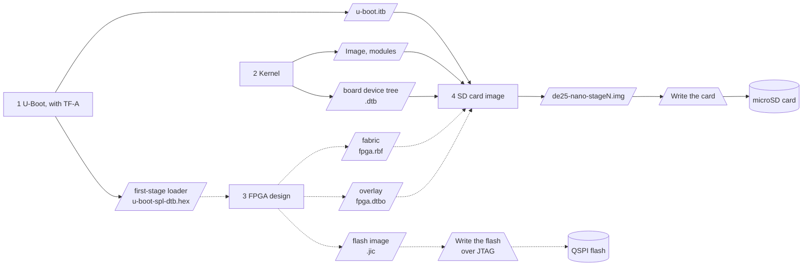

# Debian on the Terasic DE25-Nano

Debian 13 on the [Terasic DE25-Nano](https://www.terasic.com.tw/) (Altera Agilex 5 SoC FPGA) with
a kernel close to mainline, built from source on one x86 machine. The interest that started it
is precise time: a GNSS receiver's pulse per second timestamped by the Ethernet MAC's PTP clock.
The rest is useful without that: mainline Linux, Debian, the fan under control, HDMI.

Everything here is source, or a pointer to source, and the steps from source to a running
board. There are no prebuilt binaries.

## Two stages

**Stage 1: nothing flashed.** An SD card that boots a board as it comes from the factory:
Debian with the kernel built here, serial console, Ethernet with its PTP clock. Needs no Altera
software.

**Stage 2: one flash write over JTAG.** Adds our FPGA design, which U-Boot loads from the SD
card at every boot. It brings out on the 40-pin header (JP1) the PTP clock's trigger input and
pulse output, a UART, a spare I2C bus and SPI; it puts the fan controller under Linux's control;
and it shows the Linux console on HDMI at 1920x1080. After the one flash write, a changed FPGA
design is just a new file on the card.

Stage 2 needs Altera's Quartus Pro, which is free for this FPGA and comes as a Docker image
(17.5 GiB), both to build the design and to write the flash.

## The pieces

Four pieces are built from source. A rectangle is a build, a slanted box is a file, a
trapezoid is something you do by hand, a cylinder is storage on the board. Solid arrows are
needed for stage 1; dashed arrows only for stage 2.



| # | Piece | Produces | Needs first | Tool | Instructions |
|---|---|---|---|---|---|
| 1 | U-Boot, with TF-A | `u-boot.itb` for the card; the first-stage loader for the flash image | nothing | Docker | [u-boot/README.md](u-boot/README.md) |
| 2 | Kernel | `Image`, modules, the board's device tree | nothing | Docker | [kernel/README.md](kernel/README.md) |
| 3 | FPGA design | `fpga.rbf` and `fpga.dtbo` for the card; the flash image | the loader from piece 1, for its last step | Docker with the Quartus image | [fpga/README.md](fpga/README.md) |
| 4 | SD card image | the card image | pieces 1 and 2; for stage 2 also piece 3 | Docker, qemu-user | [sdimage/README.md](sdimage/README.md) |

Then two things done by hand:

- [install-card.md](install-card.md): write the card, first boot.
- [install-flash.md](install-flash.md): stage 2 only. Read the flash back, write it, and how to go back.

## Order of work

Pieces 1, 2 and 3 do not depend on each other until the last step of piece 3, so start all
three at once. Piece 4 comes last.

```
u-boot/build.sh          # piece 1, a few minutes
kernel/build.sh          # piece 2, the longest build
sdimage/build.sh stage1  # piece 4 for stage 1
```

and for stage 2 as well:

```
fpga/build.sh            # piece 3: pulls 17.5 GiB once, then about ten minutes
sdimage/build.sh stage2  # piece 4 for stage 2
```

Each script fetches the sources it needs into `work/` and leaves its results in `out/`. Both
directories are created in this repository and are not in git.

## What you need

- An x86-64 Linux machine with Docker and git, about 60 GB of free disk for stage 2 (the
  Quartus image unpacks to 34 GB) or 10 GB for stage 1, and a network connection.
- For piece 4 on x86: qemu-user with binfmt for aarch64 (Debian and Ubuntu: package
  `qemu-user-static`, or `qemu-user-binfmt`), because the Debian root filesystem is put together
  by running arm64 programs.
- A microSD card of 4 GB or more, and the board's USB-C cable for the serial console (and for
  JTAG in stage 2).

## What has been tested

All of this was developed on one board in November 2026.

| | State |
|---|---|
| Piece 1 built by its script from a clean start | yes |
| Piece 3 built by its script from a clean start; `fpga.rbf` identical to the one in use | yes |
| Piece 2 built by its script (cross-compiled on x86) | **not yet**: the kernel in use was built natively on an arm64 machine with the same source, configuration and make targets |
| Piece 4's image with stage 2 contents | built and inspected; **not yet booted as an image**: the board in use has the same files, put on its card by hand |
| Stage 2 on the board: boot with nothing typed, network, PTP trigger input and pulse output in a loop, UART loop, fan, HDMI console, SPI controller present | yes |
| Stage 1 image on a board with untouched factory flash contents | **not yet**: an earlier image booted with Terasic's own design in the flash rebuilt from Terasic's sources, which is close to the factory state but not it |
| Writing the read-back file to return to the factory state | **not yet**: the read-back verifies against the flash, the write back has not been needed |
| A GNSS receiver on the header | not yet; the loop tests use jumpers |

## Known limits

- HDMI is 1920x1080 at 60 Hz only, with no monitor detection and no frame interrupt. One KVM
  device refused the signal; a monitor and another capture device accept it.
- The board stores no Ethernet address. Give the image one when you build it (`MAC=`), or
  U-Boot invents a new one at every boot.
- U-Boot and TF-A are Terasic's forks, unchanged, with one configuration option added. The
  first-stage loader in the factory flash was built from the same source, which is why this
  U-Boot works on a factory board.
- The flash can only be written over JTAG with Altera's programmer. Writing it from U-Boot or
  Linux has not been made to work.

## Sources

| What | Where |
|---|---|
| Kernel | [jclark/linux](https://github.com/jclark/linux), branch `de25-nano-mainline/v7.4-rc2`: Linux 7.4-rc2 plus the board's device tree and Ethernet PTP changes on their way upstream |
| U-Boot | [terasic/u-boot-socfpga](https://github.com/terasic/u-boot-socfpga), branch `de25-nano-v2025.01` |
| TF-A | [terasic/arm-trusted-firmware](https://github.com/terasic/arm-trusted-firmware), branch `de25-nano-v2.12.0` |
| FPGA design | [altera-fpga/agilex5-ed-hps-baseline](https://github.com/altera-fpga/agilex5-ed-hps-baseline), tag `QPDS26.1.1_REL_GSRD_PR`, directory `terasic-de25-nano-devkit/baseline-a55`, with the changes in [fpga/](fpga/) |
| Quartus Pro 26.1.1 | Docker Hub, `alterafpga/quartus-pro:26.1.1-agilex5` |
| Debian | the Debian archive, release 13 (trixie) |

## Licence

The files written for this repository are under the MIT licence ([LICENSE](LICENSE)), except
where a file says otherwise. `fpga/top-level.patch` is a change to files of Altera's design,
which is also MIT-licensed.
