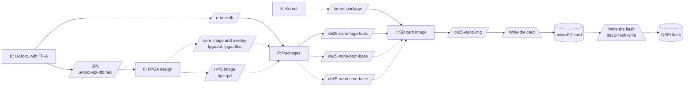

# Building from source

This page is for building the card image and the packages yourself. To install the released
image, see [install.md](install.md).

A board is brought up in two stages. Stage 1 ends with Debian running from an SD card on a
board that is otherwise untouched. Stage 2 goes on to replace the contents of the board's
flash, which lets a core image from the card be loaded into the FPGA, and adds the header
signals, fan control and HDMI.

The two differ in how the FPGA design is stored. As the board is shipped, Terasic's whole
FPGA design is in the flash, together with a boot loader, and the chip configures the FPGA
from the flash at power-on. Changing anything in the design means writing the flash again.
Stage 2 follows the arrangement of Altera's reference design instead, which Altera calls HPS
boot first. The flash holds only the HPS image: the SoC's settings, including which of its
peripherals are connected to the FPGA, and U-Boot's first stage. The FPGA's logic is a file
on the SD card, the core image, which U-Boot loads into the FPGA at every boot, so changing
the logic does not need the flash to be written again. Several core images can be installed
on a card, and one is selected.

| | Stage 1 | Stage 2 |
|---|---|---|
| What you do | Write an SD card | Also write the board's flash, once, and select a core: two commands on the board, a reboot and a power cycle |
| The flash | Left as it came from the factory | Holds the HPS image built here. The core image is then a file on the SD card, loaded at every boot. |
| What you need | Docker | Also Altera's Quartus Pro 26.3, which is free for this FPGA, installed on the build machine (38 GB), to build the FPGA design |
| Debian, near-mainline kernel, serial console, Ethernet with its PTP clock | yes | yes |
| PPS input and output, UART, I2C and SPI on the 40-pin headers | no | yes |
| Fan control | no: the fan runs at its power-on speed, which is loud | yes |
| HDMI console, 1920x1080 | no | yes |
| The way back | Put the original card back in | One command writes back the copy of the flash that was saved to the card before the write |

Stage 1 changes nothing on the board, so start there. Stage 2 can follow later with the same
SD card: one card image serves both. The image has the HPS image and the base core
installed as packages. Neither is used until a command on the board asks for it: the flash
is then written at the next boot, and after a power cycle the core is loaded at every boot.

Everything is built from source on one x86-64 Linux machine.

## What you need

- An x86-64 Linux machine with Docker and git, about 10 GB of free disk, and a network
  connection.
- For stage 2: Altera's Quartus Pro 26.3 installed on that machine, with Agilex 5 device
  support and RiscFree, another 38 GB, and `make cmake patch device-tree-compiler`.
  Getting the installer needs an account with Altera; [fpga/README.md](fpga/README.md),
  "Tools to download", has the details. Installing a release needs none of this: its
  packages carry the built FPGA design.
- For Task I on x86: qemu-user with binfmt for aarch64 (Debian and Ubuntu: package
  `qemu-user-static`, or `qemu-user-binfmt`), because the Debian root filesystem is put together
  by running arm64 programs.
- A microSD card of 4 GB or more, and the board's USB-C cable for the serial console.

The scripts use this machine's own tools where it has them, and a container where it does
not, so Docker alone is enough. On Debian or Ubuntu these packages let the kernel, the
packages, the overlay and the QEMU test run without containers: `gcc-aarch64-linux-gnu
build-essential bc bison flex libdw-dev libelf-dev libssl-dev debhelper dpkg-dev rsync cpio
kmod` (kernel), `u-boot-tools device-tree-compiler` (packages, overlay), `qemu-system-arm
mtools` (test). U-Boot is always built in its container, which has the particular compiler
it needs, and so is the image, which needs root.

## Tasks

There are five tasks, each with a letter. Four are builds from source; Task P puts their
results into packages.

- **B**: U-Boot (the boot loader), with TF-A
- **K**: the kernel
- **F**: the FPGA design
- **P**: the packages
- **I**: the SD card image

In the diagram a rectangle is a task, a slanted box is a file, a trapezoid is something you do
by hand, and a cylinder is storage on the board. Solid arrows are needed for stage 1; dashed
arrows only for stage 2.



| Task | Builds | Produces | Needs first | Tool | Instructions |
|---|---|---|---|---|---|
| B | U-Boot, with TF-A | `u-boot.itb` for the card; the SPL for the HPS image | nothing | Docker | [u-boot/README.md](u-boot/README.md) |
| K | Kernel | the kernel as a Debian package: kernel, modules and device trees | nothing | Docker | [kernel/README.md](kernel/README.md) |
| F | FPGA design | the core image `fpga.rbf`, its overlay `fpga.dtbo`, and the HPS image for the flash | the SPL from Task B, for its last step | Quartus Pro 26.3 | [fpga/README.md](fpga/README.md) |
| P | Packages | `de25-nano-fpga-tools`, `de25-nano-boot-base`, `de25-nano-core-base` | Task B and Task F for the last two | Docker | [packages/README.md](packages/README.md) |
| I | SD card image | the card image, one for both stages | Tasks K and P | Docker, qemu-user | [sdimage/README.md](sdimage/README.md) |

The results are `out/sdimage/de25-nano.img`, and the packages in `out/kernel/` and
`out/packages/`, with which a running board is updated without a new card. Write the image
to a card and carry on as in [install.md](install.md), with that file in place of the
downloaded one. [flash-jtag.md](flash-jtag.md) has the other way of writing the flash, over
JTAG.

Another FPGA design can be built on the one here, from its own repository, and installed
beside it as a package: [fpga/README.md](fpga/README.md), "Building on this design".

## Order of work

One command does all of it:

```
./build.sh          # everything; add --test to boot the result in QEMU and check it
```

It runs Tasks B, K and F at the same time, then P and I, prints a line as each starts and
finishes, and keeps each task's output in `work/logs/`. With `--no-fpga` it leaves Task F
out. `--test` adds [the test in QEMU](sdimage/README.md#testing-the-image-without-a-board),
which checks the image from the kernel upwards; what comes before the kernel, and the
board's own hardware, can only be tested on a board.

The tasks can also be run one at a time. Tasks B, K and F do not depend on each other until
the last step of Task F, so they can be started together. Tasks P and I come last, in that
order.

```
u-boot/build.sh     # Task B, a few minutes
kernel/build.sh     # Task K, about six minutes on a 24-thread machine
fpga/build.sh       # Task F, about ten minutes
packages/build.sh   # Task P, seconds
sdimage/build.sh    # Task I, five to ten minutes
```

For stage 1 alone, Task F can be left out. Task P then makes only `de25-nano-fpga-tools`,
and Task I makes `de25-nano-nofpga.img`, the same image without the boot package and the
core.

Each script fetches the sources it needs into `work/` and leaves its results in `out/`. Both
directories are created in this repository and are not in git.

If an agent is doing this for you, [AGENTS.md](AGENTS.md) tells it the order, what can run in
parallel, and where it must stop and ask you (writing the card, anything to do with the flash).

## Checking a board

The SoC's serial console is on the board's USB-C socket marked for the USB Blaster, which
gives a PC two serial ports and the JTAG cable. On Linux the console is

```
/dev/serial/by-id/usb-TERASIC_DE25-Nano_<serial number>-if02-port0
```

at 115200 baud. U-Boot counts down five seconds there before it boots; a key stops it at
its prompt, and `boot` carries on.

On the board, in stage 1:

```
uname -r                        # the kernel built in Task K
ip -br addr show end0           # an address from DHCP
ls /sys/class/ptp/              # ptp0: the Ethernet MAC's clock
sudo ethtool -T end0            # hardware timestamping
systemctl --failed              # nothing
```

and in stage 2 also:

```
sudo de25-flash status          # the flash holding the HPS image of de25-nano-boot-base
sudo de25-fpga status           # the core base selected and running
ls /dev/ttyS1                   # UART0 on the header
sudo dmesg | grep simple-framebuffer
cat /sys/class/hwmon/hwmon*/name | grep amc6821    # the fan controller
```

More tests of the header pins and of HDMI are in [tools/](tools/README.md).
