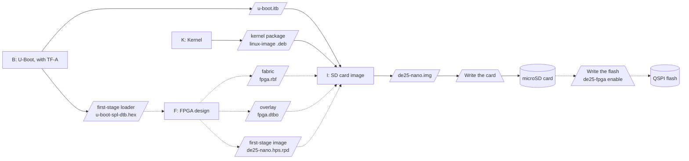

# Building from source

This page is for building the card image yourself. To install the released image, see
[install.md](install.md).

A board is brought up in two stages. Stage 1 ends with Debian running from an SD card on a
board that is otherwise untouched. Stage 2 goes on to replace the contents of the board's
flash, which lets the FPGA design in this repository be loaded, and adds the header signals,
fan control and HDMI.

The two differ in how the FPGA design is stored. As the board is shipped, Terasic's whole
FPGA design is in the flash, together with the first-stage loader, and the chip configures the
FPGA from the flash at power-on. Changing anything in the design means writing the flash
again. Stage 2 follows the arrangement of Altera's reference design instead. The
flash holds only the first-stage image: the SoC's configuration, including which of its peripherals
are connected to the FPGA, and the loader. The FPGA design itself is a file on the SD card,
which U-Boot loads into the FPGA at every boot, so changing the design does not need the flash
to be written again.

| | Stage 1 | Stage 2 |
|---|---|---|
| What you do | Write an SD card | Also write the board's flash, once: one command on the board, a reboot and a power cycle |
| The flash | Left as it came from the factory | Holds the first-stage image built here. The FPGA design is then a file on the SD card, loaded at every boot. |
| What you need | Docker | Also Altera's Quartus Pro, which is free for this FPGA and comes as a Docker image (17.5 GiB), to build the FPGA design |
| Debian, near-mainline kernel, serial console, Ethernet with its PTP clock | yes | yes |
| PPS input and output, UART, I2C and SPI on the 40-pin header | no | yes |
| Fan control | no: the fan runs at its power-on speed, which is loud | yes |
| HDMI console, 1920x1080 | no | yes |
| The way back | Put the original card back in | One command writes back the copy of the flash that was saved to the card before the write |

Stage 1 changes nothing on the board, so start there. Stage 2 can follow later with the same
SD card: one card image serves both. The image carries the FPGA design and the first-stage
image for the flash. Neither is used until one command on the board asks for it: the flash
is then written at the next boot, and after a power cycle the design is loaded at every boot.

Everything is built from source on one x86-64 Linux machine, in containers.

## What you need

- An x86-64 Linux machine with Docker and git, about 60 GB of free disk for stage 2 (the
  Quartus image unpacks to 34 GB) or 10 GB for stage 1, and a network connection.
- For Task I on x86: qemu-user with binfmt for aarch64 (Debian and Ubuntu: package
  `qemu-user-static`, or `qemu-user-binfmt`), because the Debian root filesystem is put together
  by running arm64 programs.
- A microSD card of 4 GB or more, and the board's USB-C cable for the serial console.

## Tasks

There are four tasks, each a build from source, each with a letter:

- **B**: U-Boot (the boot loader), with TF-A
- **K**: the kernel
- **F**: the FPGA design
- **I**: the SD card image

In the diagram a rectangle is a task, a slanted box is a file, a trapezoid is something you do
by hand, and a cylinder is storage on the board. Solid arrows are needed for stage 1; dashed
arrows only for stage 2.



| Task | Builds | Produces | Needs first | Tool | Instructions |
|---|---|---|---|---|---|
| B | U-Boot, with TF-A | `u-boot.itb` for the card; the first-stage loader for the flash image | nothing | Docker | [u-boot/README.md](u-boot/README.md) |
| K | Kernel | the kernel as a Debian package: kernel, modules and device trees | nothing | Docker | [kernel/README.md](kernel/README.md) |
| F | FPGA design | `fpga.rbf`, `fpga.dtbo` and the first-stage image for the flash, all for the card | the loader from Task B, for its last step | Docker with the Quartus image | [fpga/README.md](fpga/README.md) |
| I | SD card image | the card image, one for both stages | Tasks B and K, and Task F for the FPGA design | Docker, qemu-user | [sdimage/README.md](sdimage/README.md) |

The result is `out/sdimage/de25-nano.img`. Write it to a card and carry on as in
[install.md](install.md), with that file in place of the downloaded one.
[flash-jtag.md](flash-jtag.md) has the other way of writing the flash, over JTAG.

## Order of work

Tasks B, K and F do not depend on each other until the last step of Task F, so start all
three at once. Task I comes last.

```
u-boot/build.sh     # Task B, a few minutes
kernel/build.sh     # Task K, about six minutes on a 24-thread machine
fpga/build.sh       # Task F: pulls 17.5 GiB once, then about ten minutes
sdimage/build.sh    # Task I, five to ten minutes
```

For stage 1 alone, Task F can be left out. Task I then makes `de25-nano-nofpga.img`, the same
image without the FPGA design.

Each script fetches the sources it needs into `work/` and leaves its results in `out/`. Both
directories are created in this repository and are not in git.

If an agent is doing this for you, [AGENTS.md](AGENTS.md) tells it the order, what can run in
parallel, and where it must stop and ask you (writing the card, anything to do with the flash).

## Checking a board

The SoC's serial console is on the board's USB-C socket marked for the USB Blaster, which
gives a PC two serial ports and the JTAG cable. On Linux the console is

```
/dev/serial/by-id/usb-TERASIC_DE25-Nano_<serial number>-if02-port0
```

at 115200 baud. U-Boot counts down five seconds there before it boots; a key stops it at
its prompt, and `boot` carries on.

On the board, in stage 1:

```
uname -r                        # the kernel built in Task K
ip -br addr show end0           # an address from DHCP
ls /sys/class/ptp/              # ptp0: the Ethernet MAC's clock
sudo ethtool -T end0            # hardware timestamping
systemctl --failed              # nothing
```

and in stage 2 also:

```
sudo de25-fpga status           # the design enabled, the flash holding hps-first.rpd
ls /dev/ttyS1                   # UART0 on the header
sudo dmesg | grep simple-framebuffer
cat /sys/class/hwmon/hwmon*/name | grep amc6821    # the fan controller
```

More tests of the header pins and of HDMI are in [tools/](tools/README.md).

## What has been tested

All of this was developed on one board in November 2026.

| | State |
|---|---|
| Task B built by its script from a clean start | yes |
| Task K built by its script, cross-compiled on x86 | yes |
| Task F built by its script from a clean start | yes |
| Task I's image booted with nothing changed by hand afterwards | yes, on a board with the factory flash contents |
| Stage 1: the image on a board with factory flash contents | yes |
| Writing the flash from the board: `de25-fpga enable`, a reboot, U-Boot saves, writes and compares, a power cycle | yes, once. The LED blinked while it worked. Its final state was wrong in that run, dark where it should be steady on; the LED's polarity has been corrected since and the three LED states checked at the U-Boot prompt |
| Stage 2 after that, with nothing typed: the FPGA design loaded, network, the fan controller found, the HDMI set-up unit run, `/dev/mtd0` | yes |
| First-boot set-up, with the two optional files | yes |
| Going back with `de25-fpga restore`, then a power cycle | yes, once |
| Writing the flash over JTAG | yes, many times; writing the read-back that way: not yet |
