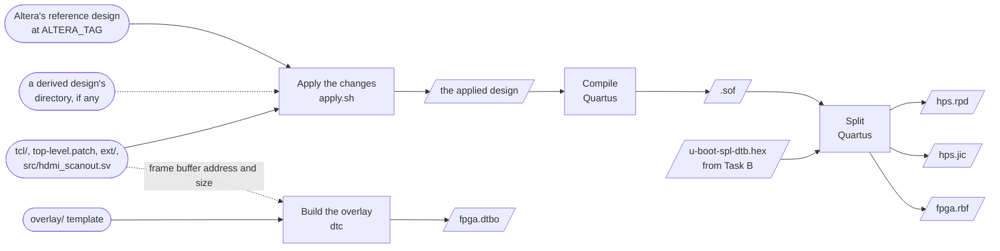

# Task F: FPGA design



Altera configures this chip in two phases, in what it calls HPS boot first mode. Phase 1 is
at power-on, from the flash: the SoC's settings and U-Boot's first stage, the SPL. This
repository calls that file the **HPS image**. Phase 2 is later, when U-Boot loads the FPGA's
logic and pins from the SD card: the **core image**. One compile gives both.

## What it produces

In `out/fpga/base/`:

| File | What it is | Where it goes | Changes when |
|---|---|---|---|
| `fpga.rbf` | The core image (phase 2): the logic in the FPGA, and its pins | Package `de25-nano-core-base`, by Task P. `de25-fpga select base` copies it to the FAT partition, and U-Boot then loads it at every boot. | the logic changes |
| `fpga.dtbo` | The device tree overlay: what Linux must be told when the core is loaded. It also carries the core's name. | The same package. `de25-fpga select base` copies it to `/boot/dtbo/`. Goes with `fpga.rbf`: both or neither. | the core's interface to Linux changes |
| `hps.rpd` | The HPS image (phase 1): the SoC's settings (its pins and memory, and which of its peripherals are routed to the FPGA) and the SPL. Raw bytes as the flash holds them (Altera's Raw Programming Data), from the start of the flash to the end of the data. | Package `de25-nano-boot-base`, by Task P. `de25-fpga select` has it written to the board's QSPI flash ([install.md](../install.md)). | the SoC's settings, the SPL or the Quartus version change; a few bytes also differ after any recompile, which does not matter (see below) |
| `hps.jic` | The same flash contents in the form Altera's programmer takes | Only for writing the flash over JTAG ([flash-jtag.md](../flash-jtag.md)) | with `hps.rpd` |
| `boot-name` | `base`: the name of the SoC settings, and so of the boot package | Read by Task P | |

A core image loads only on an HPS image with the same SoC settings, made with the same
Quartus version. It need not be from the same compile: a design recompiled with the settings
unchanged loads on the HPS image already in the flash. The chip refuses a core image that
does not fit, and the board then cannot restart until it has been power cycled.

What the base core gives Linux:

| On the board | In Linux |
|---|---|
| JP1 pin 14, input | PTP clock external timestamp, channel 1 (`extts`): a GNSS receiver's pulse per second |
| JP1 pin 6, output | PTP clock periodic output, channel 1 (`perout`) |
| JP1 pin 8 TX, pin 10 RX | UART0, `/dev/ttyS1` |
| JP1 pins 36 SCL, 38 SDA | an I2C bus (the SoC's I2C_EMAC0, `i2c@10c02a00`) |
| JP1 pins 33 SCLK, 35 MOSI, 37 MISO, 39 SS0, 40 SS1 | SPI master 0 |
| JP2 pins 36 SCL, 38 SDA | an I2C bus (the SoC's I2C_EMAC1, `i2c@10c02b00`) |
| JP2 pins 33 SCLK, 35 MOSI, 37 MISO, 39 SS0, 40 SS1 | SPI master 1 |
| the board's I2C bus with the fan controller and the HDMI transmitter | I2C bus 0: the fan controller gets its kernel driver (`amc6821`); the HDMI transmitter is set up by a script |
| HDMI socket | 1920x1080, 60 Hz video from the frame buffer at 0xBF000000 |
| user LEDs 0 to 2 (they light on a low level) | diagnostics: 0 pixel clock PLL locked, 1 PLL lost lock since load, 2 the video block ran out of data in the last half second. Healthy: LED 0 off, 1 and 2 on. |

The header signals are 3.3 V logic. On both headers pin 11 is 5 V and pin 12 is ground;
pin 29 is 3.3 V and pin 30 is ground. [how-it-works.md](../how-it-works.md) has the full pin
table, and where the headers and their pins 1 are.

## What it needs first

`out/u-boot/u-boot-spl-dtb.hex` from Task B, for the last step only. The compile and the
overlay need nothing, so start this task at the same time as Tasks B and K.

## Tools to download

- Altera's Quartus Pro, the version in `QUARTUS_VERSION` (26.3), installed on the build
  machine with Agilex 5 device support and RiscFree, which has the RISC-V compiler for the
  firmware of the design's self-test processor. The software is free for this FPGA family.
  Altera's installer is downloaded from Altera's site, which asks for an account; the
  installer then fetches its parts itself, about 17 GB, and the installation takes 38 GB.
  Altera publishes containers of Quartus Pro on Docker Hub, which need no account, but none
  yet for 26.3.
- `fpga/q COMMAND` runs a command with that Quartus on the PATH; the build script uses it.
  It looks in the directory named by `DE25_QUARTUS`, then in `~/altera/26.3` and
  `/opt/altera/26.3`, where the installer puts it, then on the PATH, and checks the version.
- The licence: the family is free but licensed. Quartus fetches the licence by itself over
  HTTPS the first time the fitter runs.
- `make`, `cmake`, `patch`, `git` and `dtc` (Debian and Ubuntu: packages `make cmake patch
  git device-tree-compiler`).

The version is not a matter of taste: a core image loads only on an HPS image made with the
same Quartus version, so everything built on this design uses the version named here.

## Source

Altera's reference design for this board, MIT-licensed:
`https://github.com/altera-fpga/agilex5-ed-hps-baseline`, the tag named in `ALTERA_TAG`
(`QPDS26.1.1_REL_GSRD_PR`), directory `terasic-de25-nano-devkit/baseline-a55`. That is the
design as Altera released it for Quartus 26.1.1, built here with Quartus 26.3. Altera's
release for 26.3 keeps the Platform Designer systems in a new form (`.vds`) that cannot be
changed by script, and all the changes here to those systems are scripts; the 26.1.1 release
has them as `.qsys` files, which Quartus 26.3 still builds. It already
loads the core image from U-Boot. Altera calls that "HPS boot first", HPS being its name for
the SoC part of the chip: the ARM CPU and its peripherals.

In this directory, applied to a clean copy of that design by `apply.sh`:

| | |
|---|---|
| `tcl/hps_connections.tcl` | Routes SoC peripherals to the FPGA: EMAC0's PTP signals, UART0, I2C0, I2C_EMAC0 and SPI master 0 (JP1), I2C_EMAC1 and SPI master 1 (JP2), and EMAC1, which makes the SoC offer the timestamp hubs' counter input. These are the SoC settings. |
| `tcl/export_connections.tcl` | Passes those connections up the three levels of the design |
| `tcl/hps_settings.tcl`, `hps-settings.txt`, `BOOT_NAME` | The SoC settings as Platform Designer reports them, the record of them, and their name (`base`): see "The SoC settings" below |
| `tcl/hdmi_base.tcl` | Adds a 148.5 MHz pixel clock and a port on system RAM (the SoC's FPGA-to-SDRAM bridge) for the video block |
| `tcl/hdmi_f2s.tcl` | Puts Altera's adapter in front of that memory port; without its marker the SoC refuses the reads |
| `top-level.patch` | The changes to the three files of Altera's that are edited by hand: the top level, the pins and project settings, the timing constraints |
| `ext/` | The base's files for the three hooks in the top level ("Building on this design" below) |
| `src/hdmi_scanout.sv` | The video block: generates the 1080p60 video timing and reads the frame buffer from system RAM. Its header comment describes it. |
| `constraints/hdmi_io.sdc` | Timing constraints for the HDMI pins |
| `sim/` | A test bench for the video block and its runner |
| `reports/` | Timing analyser scripts: the HDMI pin timing at every corner (`io.tcl`), a datasheet report, and the paths that a false-path exception hides |
| `overlay/` | The overlay template and its build script |
| `example/` | A small design built on the base |

The scripts in `tcl/` are run by Quartus's `qsys-script`; they change the Platform Designer
files (`.qsys`, `.ip`), which are machine-written and not meant to be edited by hand.

### The SoC settings

The SoC settings decide which core images load on which HPS image, and changing them means
that every board has to have its flash written again. So they have a name, in `BOOT_NAME`,
and a record, `hps-settings.txt`: the settings of the SoC component as Platform Designer
reports them, and the Quartus version. The name is the name of the boot package,
`de25-nano-boot-base`, and every core package depends on the boot package it was built for.

`apply.sh` compares the design's settings with the record and fails when they differ. For a
derived design that means it changed the SoC settings, which it must not. For the base it
means a decision:

- if core images built before the change still load on an HPS image built after it, and
  the other way round, replace `hps-settings.txt` with the `hps-settings.txt` that the
  failed run left in the design's directory, and raise `BOOT_VERSION` in `packages/VERSIONS`;
- if not, which is the case whenever a peripheral's routing or the Quartus version changes,
  also choose a new name in `BOOT_NAME`. The new boot package then installs beside the old
  one, and cores built for the old one are not offered the new HPS image.

### Building on this design

Another design can be built on this one without changing anything here, from a directory
of its own, which may be in another repository. Its core image loads on the base's HPS
image, so a board changes over to it with `de25-fpga select` and a reboot, without a flash
write. `example/` is a small one.

The derived design's directory holds:

| File | What it is |
|---|---|
| `core.conf` | `NAME=<name>`: lower-case letters, digits and hyphens. The name of the core, of its output directory and of its package, `de25-nano-core-<name>`. |
| `platform-designer.txt` | Optional. Its Platform Designer scripts, one run a line, `SYSTEM.qsys SCRIPT [ARGS...]`, run in that order after the base's. |
| `ext/ports.svh` | Optional. Ports it adds to the top level. |
| `ext/logic.svh` | Its declarations and logic, in the top-level module. |
| `ext/connections.svh` | Optional. Connections to what its Platform Designer scripts export from the SoC system. |
| `src/` | Optional. Source files, copied into the design's `src/`. |
| `constraints/*.sdc` | Optional. Timing constraint files, copied into the design's directory. |
| `assignments.qsf` | Optional. Added to the project's settings after the base's: its pins, its source files (`SYSTEMVERILOG_FILE src/...`), its constraint files (`SDC_FILE ...`). |
| `overlay/*.dtso` | Optional. Device tree source added to the base's overlay. |

The three files in `ext/` are the hooks: the base's top level includes them at fixed
places, and a derived design's files take the place of the base's.

- `ports.svh` is included in the middle of the top level's port list, and
  `connections.svh` in the middle of the SoC system's connection list, so every line in
  them ends with a comma. The base's are empty.
- `logic.svh` is included just before the SoC system is instantiated, so that
  `connections.svh` can use what it declares. Implicit wires are switched off: declare
  everything. It must drive three signals, which the base's file ties off:
  `fpga2hps_interrupts[31:0]`, the FPGA-to-SoC interrupt lines (GIC SPI 49 + bit, level);
  and `hub_cnt_clk` and `hub_cnt[63:0]`, the timestamp hubs' counter input.
- It may use the top level's ports, and `sys_clk_100` and `sys_clk_100_reset_n`, the
  100 MHz system clock and its reset.

What a derived design must not do: change the SoC settings (`apply.sh` fails if it does),
use a pin the base uses, or edit a file of the base's. If it needs something the hooks do
not give, the hook belongs in the base.

```
fpga/build.sh DIR                                  # outputs in out/fpga/<name>/
packages/mkdeb-core <name> <version> out/fpga/<name> out/packages
```

`WORK` and `OUT` in the environment put the build tree and the outputs somewhere else, for
a design in another repository. A derived build produces `fpga.rbf` and `fpga.dtbo` and no
HPS image. Its overlay is the base's with the design's fragments added, and names the core,
so that `de25-fpga` on the board can tell which core is running.

### The applied design, kept in its own repository

The result of `apply.sh` is the complete design. A copy of it is kept as one commit on top of
Altera's tag, in a copy of Altera's repository:

`https://github.com/jclark/agilex5-ed-hps-baseline`, branch `de25-nano-debian/26.1.1`

(That branch is still the design of release 0.1; it has to be made again for this one.)

That branch is made only by running `apply.sh` and is never edited by hand; its commit message
names the commit of this repository that made it. It is there so that the design can be built
without the apply step, so that it survives Altera's repository changing, and so that there is
a known good state to go back to when a newer Altera tag does not take the changes. A newer
tag gets a new branch.

To build from that repository instead of applying the changes yourself:

```
DESIGN_REPO=https://github.com/jclark/agilex5-ed-hps-baseline DESIGN_REF=de25-nano-debian/26.1.1 fpga/build.sh
```

To make such a branch (for a changed `fpga/`, or a new Altera tag named in `ALTERA_TAG`), in a
clone of that repository with Altera's repository as a remote:

```
git checkout -b de25-nano-debian/<release> <Altera's tag>
cd terasic-de25-nano-devkit/baseline-a55
<this repository>/fpga/q <this repository>/fpga/apply.sh .
git add -A && git commit        # say which commit of this repository made it
```

Then build it before publishing it.

## Commands

```
fpga/build.sh
```

It clones Altera's tag into `work/fpga/base`, runs `apply.sh` on it, which ends by checking
the SoC settings (a design that fails the check is not compiled, however often the build is
run again), compiles with Altera's own `make build` (which also generates the Platform
Designer output and builds the self-test firmware), builds the overlay, and splits the
compiled design into the HPS image, with the SPL from Task B, and the core image. The
compile takes about ten minutes and stops with an error if timing is not met.

After changing a source, delete `work/fpga/base` and run it again: Altera's Makefile does
not notice changed sources.

Check the result:

- `out/fpga/base/fpga.rbf` is about 1.9 MB, `hps.rpd` about 2.5 MB, `hps.jic` about 16.8 MB.
- The compile's log ends its timing analysis with `Timing requirements were met`.
- On the board (stage 2, with the base core selected): U-Boot prints
  `FPGA reconfiguration OK!`; Linux has `/dev/ttyS1`, a `simple-framebuffer` line in `dmesg`,
  and the fan slows from its loud power-on speed.

### The video block's simulation

```
fpga/sim/run.sh
```

About a minute, with Icarus Verilog in a small container; no Quartus and no board. It checks the
raster against CEA-861, the position of every pixel, and the memory requests, with options for
a slow, stalled or bursty memory (see the top of `sim/tb_hdmi_scanout.sv`). A good run ends
with `RESULT: raster errors 0, memory errors 0, wrong pixels 0, ...`. Change the video block
only with this passing first.

### HDMI pin timing

The HDMI transmitter (ADV7513) samples the pixel data on a clock from the FPGA. The set-up
script on the board, `de25-hdmi-init`, sets a clock delay of -800 ps in the chip, measured
on one board with this design. After a build whose HDMI pin timing has moved, look again:

```
cd work/fpga/base/agilex5-ed-hps-baseline/terasic-de25-nano-devkit/baseline-a55
../../../../../../fpga/q quartus_sta -t io.tcl        # writes io_setup*.rpt, io_hold*.rpt
```

and on the board, with a monitor connected, `tools/hdmi-test.py sweep` steps through the
chip's eight delay settings.

### The overlay alone

```
fpga/overlay/build.sh
```

It needs only `dtc`. It fills the frame buffer's address and size into the template from
`src/hdmi_scanout.sv`, adds the core's name, and compiles it. The overlay refers to the
kernel's device tree by label (`&uart0`, `&gmac0`, `&i2c0`, `&i2c2`, `&i2c3`, `&spi0`,
`&spi1`), which is why Task K builds that tree with symbols.
