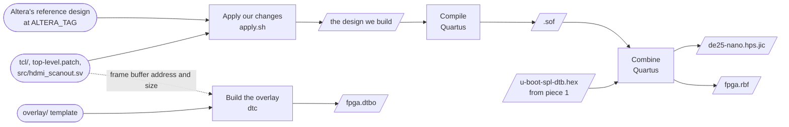

# Piece 3: FPGA design



## What it produces

| File | What it is | Where it goes | Changes when |
|---|---|---|---|
| `out/fpga/fpga.rbf` | The fabric: the logic in the FPGA | The FAT partition of the SD card, by piece 4. U-Boot loads it at every boot. | the logic changes |
| `out/fpga/fpga.dtbo` | The device tree overlay: what Linux must be told when the fabric is loaded | `/boot/dtbo/` on the card, by piece 4. Goes with `fpga.rbf`: both or neither. | the fabric's interface to Linux changes |
| `out/fpga/de25-nano.hps.jic` | The first-stage image: how the processor's pins and memory are set up, which of its peripherals are routed to the FPGA, and the first-stage loader | The board's QSPI flash, written once over JTAG ([install-flash.md](../install-flash.md)) | the processor set-up or the loader changes; not when only the logic changes |

`fpga.rbf` and the `.jic` belong together: a fabric is refused by a board whose flash holds a
first stage from a different design.

What the fabric gives Linux:

| On the board | In Linux |
|---|---|
| JP1 pin 31, input, 3.3 V | PTP clock external timestamp, channel 1 (`extts`): a GNSS receiver's pulse per second |
| JP1 pin 32, output | PTP clock periodic output, channel 1 (`perout`) |
| JP1 pin 33 RX, pin 34 TX | UART0, `/dev/ttyS1` |
| JP1 pin 35 SCL, pin 36 SDA | a spare I2C bus |
| JP1 pins 37 to 40: SCLK, MOSI, MISO, SS0 | SPI master 0 |
| the board's I2C bus with the fan controller and the HDMI transmitter | I2C bus 0: the fan controller gets its kernel driver (`amc6821`); the HDMI transmitter is set up by a script |
| HDMI socket | a 1920x1080, 60 Hz picture of the memory at 0xBF000000, used as a frame buffer |
| user LEDs 0 to 2 (they light on a low level) | diagnostics: 0 pixel clock PLL locked, 1 PLL lost lock since load, 2 the video block ran out of data in the last half second. Healthy: LED 0 off, 1 and 2 on. |

JP1 pin 29 is 3.3 V and pin 30 is ground.

## What it needs first

`out/u-boot/u-boot-spl-dtb.hex` from piece 1, for the last step only. The compile and the
overlay need nothing, so start this piece at the same time as the others.

## Tools to download

- Docker, and Altera's Quartus Pro 26.1.1 image from Docker Hub,
  `alterafpga/quartus-pro:26.1.1-agilex5`: 17.5 GiB to pull, 34 GB unpacked, no account needed.
  `quartus/Dockerfile` adds what Altera's image lacks for this design: CA certificates (without
  them the licence fetch fails with a misleading "not found in product list"), make, git,
  cmake, a RISC-V compiler for the firmware of the design's self-test processor, patch and dtc.
- The licence: this FPGA family is free but licensed. Quartus fetches the licence by itself
  over HTTPS the first time the fitter runs and keeps it in `work/quartus-home`. It is tied to
  a network card's address, so the container runs with `--net=host`.
- `fpga/q COMMAND` runs a command in that container; the build script uses it.

## Source

Altera's reference design for this board, MIT-licensed:
`https://github.com/altera-fpga/agilex5-ed-hps-baseline`, the tag named in `ALTERA_TAG`
(`QPDS26.1.1_REL_GSRD_PR`), directory `terasic-de25-nano-devkit/baseline-a55`. It already
loads the fabric from U-Boot ("HPS first").

Ours, in this directory, applied to a clean copy of that design by `apply.sh`:

| | |
|---|---|
| `tcl/hps_connections.tcl` | Routes processor peripherals to the FPGA: EMAC0's PTP signals, UART0, I2C0, the spare I2C, SPI master 0 |
| `tcl/export_connections.tcl` | Passes those connections up the three levels of the design |
| `tcl/hdmi_base.tcl` | Adds a 148.5 MHz pixel clock and a port on the processor's memory for the video block |
| `tcl/hdmi_f2s.tcl` | Puts Altera's adapter in front of that memory port; without its marker the processor refuses the reads |
| `top-level.patch` | Our changes to the three files of Altera's that are edited by hand: the top level, the pins and project settings, the timing constraints |
| `src/hdmi_scanout.sv` | The video block: makes the 1080p60 raster and reads the frame buffer out of the processor's memory. Its header comment describes it. |
| `constraints/hdmi_io.sdc` | Timing constraints for the HDMI pins |
| `sim/` | A test bench for the video block and its runner |
| `reports/` | Timing analyser scripts: the HDMI pin timing at every corner (`io.tcl`), a datasheet report, and the paths that a false-path exception hides |
| `overlay/` | The overlay template and its build script |

The scripts in `tcl/` are run by Quartus's `qsys-script`; they change the Platform Designer
files (`.qsys`, `.ip`), which are machine-written and not meant to be edited by hand.

### The applied design, kept in a fork

The result of `apply.sh` is the complete design. A copy of it is kept as one commit on top of
Altera's tag, in a fork of Altera's repository:

`https://github.com/jclark/agilex5-ed-hps-baseline`, branch `de25-nano-debian/26.1.1`

That branch is made only by running `apply.sh` and is never edited by hand; its commit message
names the commit of this repository that made it. It is there so that the design can be built
without the apply step, so that it survives Altera's repository changing, and so that there is
a known good state to go back to when a newer Altera tag does not take the changes. A newer
tag gets a new branch.

To build from the fork instead of applying the changes yourself:

```
DESIGN_REPO=https://github.com/jclark/agilex5-ed-hps-baseline DESIGN_REF=de25-nano-debian/26.1.1 fpga/build.sh
```

To make such a branch (for a changed `fpga/`, or a new Altera tag named in `ALTERA_TAG`), in a
clone of the fork with Altera's repository as a remote:

```
git checkout -b de25-nano-debian/<release> <Altera's tag>
cd terasic-de25-nano-devkit/baseline-a55
<this repository>/fpga/q <this repository>/fpga/apply.sh .
git add -A && git commit        # say which commit of this repository made it
```

Then build it before publishing it.

## Commands

```
fpga/build.sh
```

It clones Altera's tag into `work/agilex5-ed-hps-baseline`, runs `apply.sh` on it, compiles
with Altera's own `make build` (which also generates the Platform Designer output and builds
the self-test firmware), builds the overlay, and combines the compiled design with the loader
from piece 1. The compile takes about ten minutes the first time and stops with an error if
timing is not met.

After changing a source, delete `work/agilex5-ed-hps-baseline` and run it again: Altera's
Makefile does not notice changed sources.

Check the result:

- `out/fpga/fpga.rbf` is about 1.9 MB, `out/fpga/de25-nano.hps.jic` about 16.8 MB.
- The compile's log ends its timing analysis with `Timing requirements were met`.
- On the board (stage 2): U-Boot prints `FPGA reconfiguration OK!`; Linux has `/dev/ttyS1`, a
  `simple-framebuffer` line in `dmesg`, and the fan slows from its loud power-on speed.

### The video block's simulation

```
fpga/sim/run.sh
```

About a minute, with Icarus Verilog in a small container; no Quartus and no board. It checks the
raster against CEA-861, the position of every pixel, and the memory requests, with options for
a slow, stalled or bursty memory (see the top of `sim/tb_hdmi_scanout.sv`). A good run ends
with `RESULT: raster errors 0, memory errors 0, wrong pixels 0, ...`. Change the video block
only with this passing first.

### HDMI pin timing

The HDMI transmitter (ADV7513) samples the pixel data on a clock from the FPGA. The set-up
script in the SD image, `de25-hdmi-init`, sets a clock delay of -800 ps in the chip, measured
on one board with this design. After a build whose HDMI pin timing has moved, look again:

```
cd work/agilex5-ed-hps-baseline/terasic-de25-nano-devkit/baseline-a55
../../../../fpga/q quartus_sta -t io.tcl        # writes io_setup*.rpt, io_hold*.rpt
```

and on the board, with a monitor connected, `tools/hdmi-test.py sweep` steps through the
chip's eight delay settings.

### The overlay alone

```
fpga/q fpga/overlay/build.sh          # from the top of the repository
```

It needs only `dtc`. It fills the frame buffer's address and size into the template from
`src/hdmi_scanout.sv` and compiles it. The overlay refers to the kernel's device tree by
label (`&uart0`, `&gmac0`, `&i2c0`, `&i2c2`, `&spi0`), which is why piece 2 builds that tree
with symbols.
