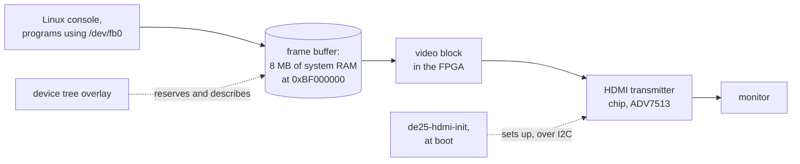

# How it works

How the parts specific to this repository work: the boot arrangement, how the pieces are
kept in step, and the hardware support provided through the FPGA.

## Booting

Altera configures this chip in two phases, in what it calls HPS boot first mode:

- **Phase 1**, at power-on, from the flash: the settings of the SoC (the chip's ARM CPU and
  its peripherals, which Altera calls the HPS) and U-Boot's first stage, the SPL. This is the
  **HPS image**.
- **Phase 2**, later, from the SD card: U-Boot loads the FPGA's logic and pins. This is the
  **core image**.

### Storage layout

**QSPI flash, on the board.**

- Stage 1: the factory contents, Terasic's whole FPGA design with a boot loader.
- Stage 2: the HPS image of the boot package (`hps.rpd`), and no FPGA logic. Written by
  `de25-flash write`, or over JTAG ([flash-jtag.md](flash-jtag.md)).

**SD card, partition 1.** FAT, 64 MB, mounted at `/boot/firmware`. This is what U-Boot uses.

| File | What it is |
|---|---|
| `u-boot.itb` | U-Boot with TF-A |
| `boot.scr` | The U-Boot script |
| `uboot.env` | U-Boot's saved settings, if any have been saved |
| `fpga.rbf`, `fpga-core.txt` | The selected core image and its name; there only after `de25-fpga select` (stage 2) |
| `write-on-boot.rpd`, `write-on-boot.txt` | The new flash contents and their crc32; there only between `de25-flash write` on a board with the factory flash contents and the boot that writes the flash |
| `saved-<crc32>.rpd` | What the flash held before U-Boot wrote it, the whole 16 MiB, named by its crc32 |
| `write-on-boot-failed.txt` | There only if the last flash write failed: the step it failed in, for `de25-flash status` |
| `u-boot-previous.itb` | The `u-boot.itb` that was there before the last change |

**SD card, partition 2.** ext4, the rest of the card, mounted at `/`: Debian.

| File | What it is |
|---|---|
| `/boot/vmlinuz-<release>` | The kernel, gzip-compressed, from the kernel package |
| `/usr/lib/linux-image-<release>/intel/socfpga_agilex5_de25_nano.dtb` | The kernel's device tree for the board, from the kernel package |
| `/boot/extlinux/extlinux.conf` | The boot menu, written by Debian's `u-boot-update` from `/etc/default/u-boot` |
| `/usr/lib/de25-nano/boot/base/` | The boot package `de25-nano-boot-base`: `hps.rpd`, `u-boot.itb`, `boot.scr`. The boot does not look here. |
| `/usr/lib/de25-nano/core/<name>/` | A core package, `de25-nano-core-<name>`: `fpga.rbf`, its overlay `fpga.dtbo`, and `boot`, the name of the boot package it was built for. The boot does not look here. |
| `/boot/dtbo/fpga.dtbo` | The selected core's overlay; there only after `de25-fpga select` (stage 2) |

### Boot sequence

1. At power-on the chip reads the flash, configures the SoC and runs the SPL from the flash.
   With the factory flash contents it configures the FPGA from the flash first.
2. The SPL sets up the memory and loads `u-boot.itb` from partition 1. TF-A starts, then
   U-Boot.
3. U-Boot scans the bootable partitions. On partition 1 it runs `boot.scr`. If a flash write
   is waiting (`write-on-boot.rpd` on partition 1) and the chip keeps the flash from the SoC,
   the script writes the flash and goes no further ([Writing the flash](#writing-the-flash)).
   Otherwise it sets three things U-Boot's own configuration for this board lacks: the name
   of the device tree file, the address overlays are loaded to, and the address and size
   limit for unpacking a compressed kernel. If `fpga.rbf` is on partition 1 and the chip has
   handed the flash to the SoC, it also loads the file into the FPGA. `de25-fpga select`
   puts the file there; a board with the factory flash contents does not accept a core
   image, and the script does not offer it one.
4. On partition 2 it reads the boot menu. The menu has an entry for each installed kernel; the
   first, the newest, is the default. From the entry U-Boot loads the kernel, the device tree
   from that kernel's own directory and, if the core image loaded, the overlay, which it
   applies to the device tree.
5. The kernel file is gzip-compressed. U-Boot recognises that, unpacks it to the address
   `boot.scr` gave, moves the result back to the address it loads kernels at, and starts it
   with the device tree.
6. Linux starts with partition 2 as its root. In stage 2 a udev rule sets the fan curve and a
   unit sets up the HDMI transmitter.

The addresses, all in the board's 1 GB of RAM, which starts at 0x80000000:

| Address | Use | Set in |
|---|---|---|
| 0x82000000 | The kernel file is loaded here; the unpacked kernel is moved back here before it is started | U-Boot's configuration (`kernel_addr_r`) |
| 0x86000000 | The device tree | U-Boot's configuration (`fdt_addr_r`) |
| 0x87000000 | Each overlay, while it is applied | `boot.scr` (`fdtoverlay_addr_r`) |
| 0x90000000 | The kernel is unpacked here first | `boot.scr` (`kernel_comp_addr_r`; `kernel_comp_size` limits the compressed kernel to 32 MB) |
| 0xBF000000 | The HDMI frame buffer, 8 MB, in stage 2 | The base core and its overlay |

### Keeping the pieces in step

Three things have to fit each other, and they live in two places: the flash on the board,
and the card.

| What | Must fit | How it is kept so |
|---|---|---|
| The core image, on the card | The SoC settings in the flash's HPS image: the chip refuses a core image built for other settings, and the board then cannot restart until it is power cycled | The settings have a name, `base`, which is the name of the boot package, `de25-nano-boot-base`. Every core package depends on the boot package it was built for, and `de25-fpga select` wants to see that the core fits before it puts it on the card. |
| `u-boot.itb` and `boot.scr`, on the card | The SPL in the flash: the same U-Boot source | The three are one package and are put in place together, by `de25-flash write`. |
| The overlay, on the card | The core image | Both come from one package and are copied together. U-Boot applies the overlay only if the core image loaded. |

Linux has no way to ask the flash what its SoC settings are. `de25-fpga select` takes a
core to fit when one of these holds:

- the core now running was built for the same boot package: a running core is proof of what
  the flash holds. Linux knows which core is running from two properties its overlay puts
  in the device tree, `/chosen/de25-nano,core` and `/chosen/de25-nano,boot`;
- the flash holds, byte for byte, the HPS image of that boot package as installed;
- a flash write of that HPS image is waiting for the next boot.

A card moved to a board with other flash contents escapes all three: the core is refused
once, `de25-fpga status` says so, and the board needs a power cycle.

Nothing writes the flash except `de25-flash write` and `de25-flash restore`, which ask
first. Installing or upgrading packages changes what the board runs only where that cannot
leave it unable to start:

| Package upgraded | Effect |
|---|---|
| The kernel | The next boot runs it; the previous one stays in the boot menu |
| The selected core | The next boot loads it. If the new version was built for another boot package, the card keeps the old one and the upgrade says so. |
| The boot package | If the flash holds exactly the new package's HPS image, `u-boot.itb` and `boot.scr` on the card are renewed. If not, the card is left alone until `de25-flash write`. |

### Writing the flash

The flash belongs to the chip's Secure Device Manager (SDM), the part of the chip that
configures it at power-on. Whether the SoC gets direct access is a setting of the design in
the flash. The HPS image built here hands the flash over, and Linux then has it as
`/dev/mtd0`. Terasic's factory contents do not: there, neither U-Boot's flash driver nor
Linux can reach it. The SDM's own commands for reading, erasing and writing the flash work
all the same, and U-Boot can send them. That is how a factory board's flash is written
without JTAG.

| Part | Where it is | What it does |
|---|---|---|
| `sdmflash` | A U-Boot command, added by `u-boot/qspi-flash.patch` | Reads, erases and writes the flash through the SDM |
| `hps.rpd` | `/usr/lib/de25-nano/boot/base`, from the boot package | The new flash contents as raw bytes, from the start of the flash to the end of the data (about 2.5 MB of the 16 MiB) |
| `de25-flash write` | `/usr/sbin`, from `de25-nano-fpga-tools` | Puts the boot package's `u-boot.itb` and `boot.scr` on the FAT partition. On a board where Linux has no `/dev/mtd0` it then copies `hps.rpd` there as `write-on-boot.rpd`, with its crc32 in `write-on-boot.txt`. On a board where Linux has the flash it writes `hps.rpd` to `/dev/mtd0` itself. |
| `boot.scr` | The FAT partition | When `write-on-boot.rpd` is there and the SDM has kept the flash: checks the file's size and crc32 and removes it; reads the whole flash, saves it as `saved-<crc32>.rpd` unless that file is already there, and reads the save back from the card; only then erases, writes, reads back and compares; and stays there. On failure it records the failing step in `write-on-boot-failed.txt`. |
| `HPS_LED` | The one LED wired to the SoC | Shows progress: slow blinking while working, steady on when done, fast blinking on failure |
| `de25-flash restore` | `/usr/sbin` | Writes a `saved-<crc32>.rpd` back from Linux through `/dev/mtd0` |

The chip takes up new flash contents only at power-on, so a power cycle follows the write.
The script tells from U-Boot's variable `qspi_clock` whether the SDM kept the flash: the
SPL records the flash controller's clock rate when it is given the flash, and the variable
is zero when it was not.

## Stage 2 features

What the base core adds, once the flash has been written and the core selected.

### Header pins

The board has two 40-pin headers. JP1 (GPIO 0) is the one along the edge of the board with
the DC jack and the USB-C sockets; the board has "GPIO_0" printed beside it. Its pin 1 is at
the DC-jack end, in the row nearer the middle of the board: its solder pad on the underside
is the square one. JP2 (GPIO 1) is along the opposite edge, turned half a turn: its pin 1 is
at the end with the slide switches, again in the row nearer the middle of the board. On both,
the odd-numbered pins are that inner row and the even-numbered pins the row at the board's
edge. The signals are 3.3 V logic.

| Pin | JP1 | In Linux | JP2 | In Linux |
|---|---|---|---|---|
| 6 | PPS out (output) | PTP clock `/dev/ptp0`, periodic output channel 1 | | |
| 8 | UART0 TX (output) | `/dev/ttyS1` | | |
| 10 | UART0 RX (input) | `/dev/ttyS1` | | |
| 11 | 5 V (up to 1 A) | | 5 V | |
| 12 | ground | | ground | |
| 14 | PPS in (input) | PTP clock `/dev/ptp0`, external timestamp channel 1 | | |
| 29 | 3.3 V (up to 1.5 A) | | 3.3 V | |
| 30 | ground | | ground | |
| 33 | SPI SCLK (output) | SPI master 0 | SPI SCLK (output) | SPI master 1 |
| 35 | SPI MOSI (output) | SPI master 0 | SPI MOSI (output) | SPI master 1 |
| 36 | I2C SCL | I2C bus `i2c2` | I2C SCL | I2C bus `i2c3` |
| 37 | SPI MISO (input) | SPI master 0 | SPI MISO (input) | SPI master 1 |
| 38 | I2C SDA | I2C bus `i2c2` | I2C SDA | I2C bus `i2c3` |
| 39 | SPI SS0 (output) | SPI master 0 | SPI SS0 (output) | SPI master 1 |
| 40 | SPI SS1 (output) | SPI master 0 | SPI SS1 (output) | SPI master 1 |

The other pins are not connected by the base core. The positions leave room for a design
built on the base to put more pulse inputs and serial ports beside them.

This is not a Raspberry Pi's header. Only the UART is where a Raspberry Pi has it; the
power pins are elsewhere (here 5 V is pin 11 and ground is pin 12), so a Raspberry Pi add-on
board cannot be plugged in, and a cable wired for a Raspberry Pi's power pins must not be
used as it is.

The I2C pins have only the FPGA's weak internal pull-ups; a device on those buses may need
its own pull-up resistors.

### HDMI

HDMI output is a scan-out of a frame buffer in system RAM: logic in the FPGA reads the frame
buffer and drives the board's HDMI transmitter. Linux uses it as a `simple-framebuffer`
(`/dev/fb0`); there is no DRM driver. The mode is fixed at 1920x1080, 60 Hz.

| Part | Where it is | What it does |
|---|---|---|
| Frame buffer | 8 MB of system RAM at 0xBF000000, reserved | Holds one frame: 1920x1080 pixels, 32 bits per pixel (`x8r8g8b8`) |
| Video block, `fpga/src/hdmi_scanout.sv` | In the base core (`fpga.rbf`) | Generates the 1080p60 video timing from a 148.5 MHz pixel clock, and reads the frame buffer from system RAM once per frame through the SoC's FPGA-to-SDRAM bridge. It has no registers: it runs as soon as the core image is loaded. |
| HDMI transmitter, ADV7513 | A chip on the board | Converts the FPGA's parallel RGB, sync and clock signals to HDMI |
| `de25-hdmi-init` and its systemd unit | `/usr/sbin`, from `de25-nano-fpga-tools` | Configures the transmitter over I2C at every boot; the I2C bus reaches the chip through the FPGA. The output is always enabled and the monitor's EDID is not read. |
| Device tree overlay, `fpga.dtbo` | On the card | Reserves the 8 MB, and describes the frame buffer in a `simple-framebuffer` node |
| Kernel | `CONFIG_FB_SIMPLE`, from the config fragment | Provides `/dev/fb0` from that node |
| Boot menu | `console=tty0` | Puts the text console on the frame buffer |

The frame buffer's address and the resolution are defined in one place, the video block's
source; the overlay's build takes them from there.

### Fan

The fan is driven by a fan controller chip on the board (AMC6821). Linux can only reach it
through the core image, so in stage 1 the fan runs at the chip's power-on speed, which is loud.

| Part | Where it is | What it does |
|---|---|---|
| Fan controller, AMC6821 | A chip on the board, on the same I2C bus as the HDMI transmitter | Drives the fan's PWM input and measures its speed; has its own temperature sensor (the board) and reads the FPGA's temperature diode |
| I2C route | In the base core | Connects that I2C bus to the SoC's I2C0 controller |
| Device tree overlay, `fpga.dtbo` | On the card | Enables I2C0 and declares the controller, with the fan's PWM polarity inverted, as it is on this board |
| Kernel | The `amc6821` hwmon driver (a module in arm64 defconfig) | Provides the controller under `/sys/class/hwmon` |
| `60-de25-fan.rules` and `de25-fan-curve` | From `de25-nano-fpga-tools`: `/usr/lib/udev/rules.d`, `/usr/sbin` | The udev rule runs the script when the hwmon device appears; the script sets the fan curve |
| `/etc/default/de25-fan` | From `de25-nano-fpga-tools` | The settings for the curve, read by the script |

The curve is held in the controller, which then follows the FPGA's temperature by itself; no
daemon is involved. The settings in `/etc/default/de25-fan`:

| Setting | Default | Meaning |
|---|---|---|
| `FAN_MIN_PWM` | 90 | The fan drive at its minimum, of 255: about 5,200 rpm |
| `FAN_MIN_TEMP` | 64 | The FPGA temperature, in °C, up to which the fan stays at the minimum |
| `FAN_FULL_TEMP` | 76 | The FPGA temperature at which the fan reaches full speed. The controller supports only certain slopes; with these defaults it settles on 74 °C. |

After changing them, reboot, or apply them at once with
`sudo udevadm trigger --action=add --subsystem-match=hwmon`. With the defaults, on one board
with Linux idle, the FPGA sits near 58 °C and the board sensor near 37 °C.
