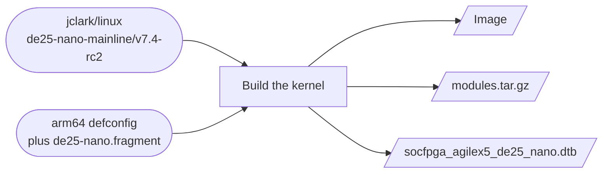

# Task K: Kernel



## What it produces

| File | What it is | Where it goes |
|---|---|---|
| `out/kernel/Image` | The kernel, uncompressed | `/boot/vmlinuz-<release>` on the card, by Task I |
| `out/kernel/modules.tar.gz` | The modules, as `usr/lib/modules/<release>/` | Unpacked into the root filesystem, by Task I |
| `out/kernel/dtbs/socfpga_agilex5_de25_nano.dtb` | The board's device tree | `/boot/dtbs/<release>/` on the card, by Task I |
| `out/kernel/config` | The configuration used | `/boot/config-<release>`, for reference |

The device tree describes the board as it leaves the factory: what is wired to the
processor's own pins. It has nothing that needs our FPGA design; that is in the overlay built
by Task F. It is built with symbols (`dtc -@`), so that U-Boot can apply the overlay to it.

## What it needs first

Nothing.

## Tools to download

Docker. `kernel/Dockerfile` is Debian 13 with the `aarch64-linux-gnu` cross-compiler and what
the kernel build needs.

## Source

`https://github.com/jclark/linux`, branch `de25-nano-mainline/v7.4-rc2`: Linux 7.4-rc2 plus a
short stack of patches that are on their way upstream:

- the board: a binding entry, the SD host node for Agilex 5, and the DE25-Nano device tree;
- Ethernet (stmmac, the XGMAC core in this chip): external timestamps (`extts`) made to work,
  fixes around them, and the split header feature switched off on Agilex 5, where it
  gave corrupted received data on this board;
- the route for the PTP trigger from the FPGA (`altr,f2h-ptp-aux-trig`);
- one commit that builds the board's device tree with symbols.

The branch is rebuilt when those patches change, each time under a new branch name; this file
will name the new one.

Configuration: arm64 `defconfig`, then `scripts/kconfig/merge_config.sh` with
`de25-nano.fragment`, which sets three options. The reasons are in the file: the chip's
temperature and voltage sensors, the DMA controller the SPI nodes name, and the simple frame
buffer for HDMI.

## Commands

```
kernel/build.sh
```

It clones the branch into `work/linux` (a shallow clone), configures, cross-compiles
`Image modules dtbs`, and installs the modules, stripped, into a tar file. The build tree is
`work/linux-obj`.

**This script has not been run yet.** The kernel that the board runs was built natively on an
arm64 machine from the same branch with the same configuration and make targets. If you have
an arm64 machine, the native build is the same commands without `ARCH` and `CROSS_COMPILE`:

```
make O=obj defconfig
scripts/kconfig/merge_config.sh -m -O obj obj/.config <this directory>/de25-nano.fragment
make O=obj olddefconfig
make O=obj -j$(nproc) Image modules dtbs
make O=obj INSTALL_MOD_PATH=<stage>/usr INSTALL_MOD_STRIP=1 modules_install
```

then `obj/arch/arm64/boot/Image`, `obj/arch/arm64/boot/dts/intel/socfpga_agilex5_de25_nano.dtb`
and a tar of `<stage>` (so that it unpacks to `usr/lib/modules/<release>/`; remove the `build`
and `source` links in that directory first) go into `out/kernel/` under the names in the table
above.

Check the result:

- The script checks that the three options from the fragment are in the final configuration.
- `tar tzf out/kernel/modules.tar.gz | head -3` starts with `usr/`, `usr/lib/`,
  `usr/lib/modules/`.
- On the board: `uname -r` shows the release; `dmesg` shows
  `PHY [stmmac-0:01] driver [Micrel KSZ9031 Gigabit PHY]`; `/sys/class/ptp/ptp0` exists.
