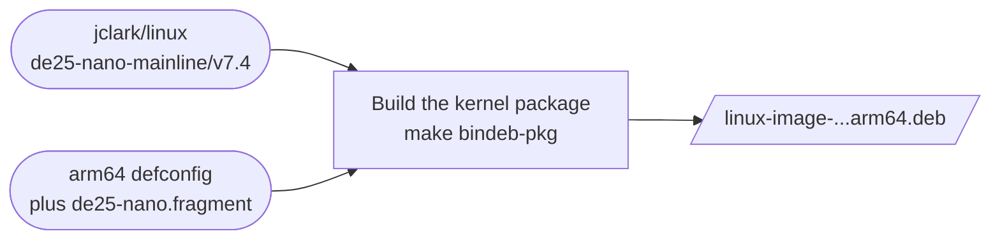

# Task K: Kernel



## What it produces

| File | What it is | Where it goes |
|---|---|---|
| `out/kernel/linux-image-<release>_<version>_arm64.deb` | The kernel as a Debian package, made by the kernel's own `make bindeb-pkg` | Installed in the image by Task I; it can also be installed on a running board with `dpkg -i` |
| `out/kernel/config` | The configuration used | For reference; the package also installs it as `/boot/config-<release>` |

What the package installs:

| Path | What it is |
|---|---|
| `/boot/vmlinuz-<release>` | The kernel, gzip-compressed, as is usual for arm64 |
| `/lib/modules/<release>/` | The modules |
| `/usr/lib/linux-image-<release>/intel/socfpga_agilex5_de25_nano.dtb` | The board's device tree, with the kernel's other arm64 device trees beside it |

The device tree describes the board as it leaves the factory: what is wired to the SoC's own
pins. It has nothing that needs the FPGA design in this repository; that is in the overlay
built by Task F. It is built with symbols (`dtc -@`), so that U-Boot can apply the overlay to
it.

Installing or removing the package runs Debian's kernel hooks. In the image, the
`u-boot-menu` package uses them to rewrite the boot menu, so the kernel can be replaced on a
running board by installing a newer package.

## What it needs first

Nothing.

## Tools to download

Docker. `kernel/Dockerfile` is Debian 13 (trixie) with these packages, which are also what a
Debian or Ubuntu machine needs to do the build without Docker:

| Packages | For |
|---|---|
| `build-essential` | The compiler and tools for the programs the kernel build runs on the build machine |
| `gcc-aarch64-linux-gnu` | The cross-compiler for the kernel itself (not needed on an arm64 machine) |
| `bc bison flex kmod libdw-dev libelf-dev libssl-dev python3 rsync` | The build dependencies that the kernel's packaging names |
| `debhelper dpkg-dev` | `dpkg-buildpackage` and the debhelper commands that `make bindeb-pkg` uses |
| `cpio perl xz-utils` | Used by parts of the kernel build |
| `git ca-certificates` | Fetching the source; the build also reads the source's git state for the release name |

## Source

`https://github.com/jclark/linux`, branch `de25-nano-mainline/v7.4`: Linux 7.4-rc2 plus a
short stack of patches that are on their way upstream:

- the board: a binding entry, the SD host node for Agilex 5, and the DE25-Nano device tree;
- Ethernet (stmmac, the XGMAC core in this chip): external timestamps (`extts`) made to work,
  fixes around them, and the split header feature switched off on Agilex 5, where it
  gave corrupted received data on this board;
- the route for the PTP trigger from the FPGA (`altr,f2h-ptp-aux-trig`);
- a fix that lets programs request external timestamps with strict flag checking
  (`PTP_EXTTS_REQUEST2`), which SatPulse needs;
- one commit that builds the board's device tree with symbols.

The branch only moves forward: changes to those patches, and newer 7.4 release candidates, are
added on top of it, and it is never rewritten. When the base moves to 7.5, a new branch
`de25-nano-mainline/v7.5` will be started, and this file will name it.

Configuration: arm64 `defconfig`, then `scripts/kconfig/merge_config.sh` with
`de25-nano.fragment`, which sets three options. The reasons are in the file: the chip's
temperature and voltage sensors, the DMA controller the SPI nodes name, and the simple frame
buffer for HDMI.

## Commands

```
kernel/build.sh
```

It clones the branch into `work/linux` (a shallow clone, about 300 MB), configures, and runs
`make bindeb-pkg` for arm64 in the container. The build tree is `work/linux-obj`; a second run
reuses it. About six minutes on a 24-thread machine.

What the script sets, and why:

| Setting | Why |
|---|---|
| `ARCH=arm64`, `CROSS_COMPILE=aarch64-linux-gnu-` (in the Dockerfile) | Cross-compile. On an arm64 machine leave both out. |
| `LOCALVERSION=-de25-nano-<date>` | The date of the source's last commit. The release is then `7.4.0-rc2-de25-nano-<date>-g<commit>`, so releases sort by age and the newest installed kernel is the boot menu's default |
| `DEB_BUILD_PROFILES="pkg.linux-upstream.nokernelheaders pkg.linux-upstream.nokerneldbg"` | No `linux-headers` package, which when cross-compiling would need arm64 libraries on the build machine, and no debug symbols package, which is large |
| `KBUILD_BUILD_USER`, `KBUILD_BUILD_HOST` | The kernel records who built it and where; the packaging also needs a user name, which the user in the container does not have |
| `KDEB_CHANGELOG_DIST=trixie` | The distribution named in the package's changelog; without it the packaging wants `lsb-release` |

Check the result:

- The script checks that the three options from the fragment are in the final configuration.
- `dpkg-deb -c out/kernel/linux-image-*.deb | grep de25_nano` shows the board's device tree.
- On the board: `uname -r` shows the release; `dmesg` shows
  `PHY [stmmac-0:01] driver [Micrel KSZ9031 Gigabit PHY]`; `/sys/class/ptp/ptp0` exists.
