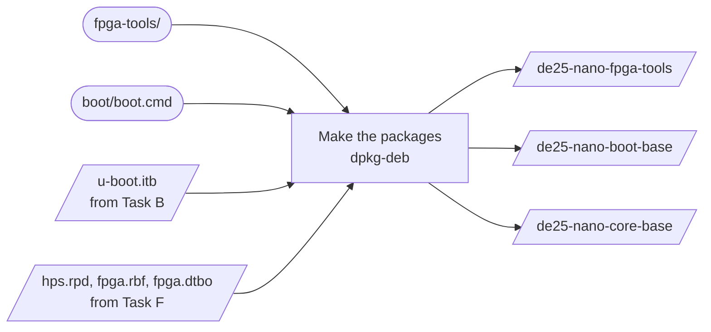

# Task P: Packages



## What it produces

Three Debian packages in `out/packages/`, for what the image needs and the Debian archive
does not have. With the kernel package from Task K they are everything on a card that is
not Debian's, so a running board is brought up to date by installing newer ones.

| Package | What is in it | When it takes effect on a board |
|---|---|---|
| `de25-nano-fpga-tools` | `de25-flash` and `de25-fpga` with their man pages; the fan curve's udev rule, script and settings; the HDMI transmitter's set-up script and unit | When it is installed |
| `de25-nano-boot-base` | What runs before the kernel, built together: `hps.rpd`, the HPS image for the flash; `u-boot.itb`; `boot.scr`. In `/usr/lib/de25-nano/boot/base/`. | `sudo de25-flash write` writes the flash and puts the other two on the card. If the flash already holds exactly this HPS image, installing the package puts the other two on the card by itself. The flash is never written by installing a package. |
| `de25-nano-core-base` | The base core image and its overlay, `fpga.rbf` and `fpga.dtbo`, in `/usr/lib/de25-nano/core/base/`. Depends on `de25-nano-boot-base`. | `sudo de25-fpga select base`, from the next boot on. Once it is the selected core, a newer version takes effect at the next boot by itself, as a kernel does. |

How they belong together:

- **`base` in the boot package's name is the name of the SoC settings** (`fpga/BOOT_NAME`).
  A core image loads only on an HPS image with the same settings, so every core package
  depends on the boot package it was built for. Several cores can depend on one boot
  package, and be installed side by side; one of them is selected.
- **A boot package for other SoC settings has another name** and installs beside this one.
  `de25-flash write <name>` chooses.
- **A core built on the base in another project** is packaged with `mkdeb-core` from here
  ([fpga/README.md](../fpga/README.md), "Building on this design") and depends on
  `de25-nano-boot-base` in the same way.

The commands are described in their man pages, `de25-flash(8)` and `de25-fpga(8)`
(`fpga-tools/man/`), and how the board uses the files in
[how-it-works.md](../how-it-works.md).

## What it needs first

- Nothing for `de25-nano-fpga-tools`.
- Task B, `out/u-boot/u-boot.itb`, and Task F, `out/fpga/base/`, for the other two. Without
  Task F only the first package is made.

## Tools to download

`dpkg-deb` and `mkimage` (Debian and Ubuntu: packages `dpkg` and `u-boot-tools`). Without
them on the machine, Docker: the packages are then made in the container of Task I
(`sdimage/Dockerfile`), which has both.

## Source

| | |
|---|---|
| `fpga-tools/de25-flash`, `de25-fpga`, `common.sh` | The two commands and what they share |
| `fpga-tools/man/` | Their man pages |
| `fpga-tools/test.sh` | A test of the two commands off the board, against a made-up card and a file standing in for the flash |
| `fpga-tools/60-de25-fan.rules`, `de25-fan-curve`, `de25-fan.default` | The fan curve: udev rule, script, settings (`/etc/default/de25-fan`) |
| `fpga-tools/de25-hdmi-init`, `de25-hdmi-init.service` | The HDMI transmitter's set-up |
| `boot/boot.cmd` | The U-Boot script, wrapped into `boot.scr` |
| `VERSIONS` | The three packages' versions |
| `build.sh`, `inner.sh`, `mkdeb-core` | The build: the packages are put together with `dpkg-deb` from files that are already built |

### Versions

| In `VERSIONS` | Raise it when |
|---|---|
| `TOOLS_VERSION` | anything in `fpga-tools/` changes |
| `CORE_BASE_VERSION` | the base core or its overlay changes |
| `BOOT_VERSION` | the SoC settings, U-Boot (`u-boot/`), `boot/boot.cmd` or the Quartus version change |

The boot package is kept from one release to the next for as long as `BOOT_VERSION` stands.
A recompile of the FPGA design gives an HPS image that differs in a few bytes even when
nothing that matters has changed, and a board compares its flash with the installed HPS
image byte for byte: a boot package made again without need would have every board told
that its flash wants writing. So `build.sh` does not make the boot package again when
`out/packages/` already has one with the version in `VERSIONS`; `REBUILD_BOOT=1` overrides
that. For a release, start from the previous release's boot package in `out/packages/`
unless `BOOT_VERSION` was raised.

## Commands

```
packages/build.sh
```

Seconds. Check the result:

- `dpkg-deb -I` and `dpkg-deb -c` on each file in `out/packages/`.
- `packages/fpga-tools/test.sh` ends with `all 29 tests passed`. Run it after any change to
  the two commands.
- On a board: `sudo apt install ./de25-nano-*.deb`, then `sudo de25-flash status` and
  `sudo de25-fpga status`.

A core of a derived design:

```
packages/mkdeb-core <name> <version> out/fpga/<name> out/packages
```
