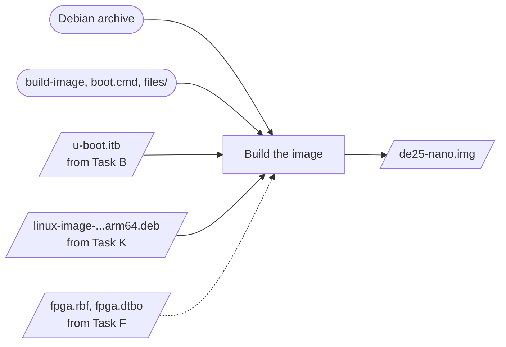

# Task I: SD card image



## What it produces

`out/sdimage/de25-nano.img`: a complete card image, 3 GB (about 115 MB compressed with `xz`),
to be written to a microSD card ([install-card.md](../install-card.md)).

It is one image for every board. It carries the FPGA design and its device tree overlay in
`/usr/lib/de25-nano/`, where the boot does not use them, so a new card boots without the
design, which is stage 1. On a board whose flash has been written for stage 2,
`sudo de25-fpga enable` copies the two files to where the boot uses them, and
`sudo de25-fpga disable` removes them again. They are not there from the start because a
board with the factory flash contents does not accept the design.

When Task F has not been built, the script makes `out/sdimage/de25-nano-nofpga.img` instead:
the same image without the FPGA design and its overlay.

Partition 1: FAT, 64 MB, mounted at `/boot/firmware`.

- `u-boot.itb`
- `boot.scr`, the U-Boot script
- `README.txt`
- once enabled: `fpga.rbf`, the FPGA design

Partition 2: ext4, the rest of the card, mounted at `/`.

- Debian 13, with the kernel package from Task K installed
- `/boot/extlinux/extlinux.conf`, the boot menu
- `/usr/lib/de25-nano/fpga.rbf` and `fpga.dtbo`, the FPGA design and its overlay as the image
  brings them
- once enabled: `/boot/dtbo/fpga.dtbo`, the overlay where the boot menu finds it

Both partitions are marked bootable, because U-Boot scans only those: partition 1 for the
script, then partition 2 for the menu.

This task owns the layout of the card, so the pieces that make it boot are here:

- **`boot.cmd`**, wrapped into `boot.scr` during the build. It gives U-Boot what its own
  configuration for this board lacks: the name of the device tree file inside a kernel
  package's directory, and the address and size limit for unpacking a compressed kernel. If
  `fpga.rbf` is on the partition it loads it, and only when that has succeeded does it set
  the address overlays are loaded to; without that address U-Boot skips the overlay named in
  the boot menu.
- **The boot menu** is written by Debian's `u-boot-menu` package (`u-boot-update`), not by
  this task. It makes an entry for every installed kernel, newest first, each with that
  kernel's own device tree directory, and it names every overlay it finds in `/boot/dtbo`. It
  runs again whenever a kernel package is installed or removed. Its settings are in
  `/etc/default/u-boot` (from `files/u-boot.default`): the kernel command line and the menu's
  timeout.
- **`files/`** also has `de25-fpga`, and what the FPGA design needs in Linux: the udev rule,
  script and settings file for the fan curve, and the script and unit that set up the HDMI
  transmitter. Without the FPGA design they do nothing.

### First boot

Nothing in the image is specific to a person or a board. The first boot of a card
(`files/de25-firstboot`, run once, before the network comes up) does the rest:

- makes new ssh host keys;
- grows partition 2 to fill the card;
- makes up an Ethernet address and keeps it in `/etc/systemd/network/10-emac0.link`. The
  board stores none, and U-Boot would otherwise invent a new one at every boot. The interface
  keeps Debian's usual name for it, `end0`;
- reads two optional files that the user put on the FAT partition beforehand, from any
  computer:

| File on the FAT partition | Effect |
|---|---|
| `hostname` | One line: the board's host name. Without it the name is `de25-nano`. |
| `authorized_keys` | ssh public keys for the user. With it, ssh accepts keys only. |

The user is `debian`, with `sudo` without a password. Without an `authorized_keys` file the
password is `debian` and has to be changed at the first login. The network uses DHCP.

## What it needs first

- Task B: `out/u-boot/u-boot.itb`.
- Task K: `out/kernel/linux-image-*_arm64.deb`.
- Task F, for the complete image: `out/fpga/fpga.rbf` and `out/fpga/fpga.dtbo`.

## Tools to download

Docker. On a host that is not arm64, qemu-user with binfmt for aarch64 (Debian and Ubuntu:
`qemu-user-static` or `qemu-user-binfmt`): the build runs arm64 programs while it puts the
root file system together. Check with `ls /proc/sys/fs/binfmt_misc/ | grep aarch64`.

The build runs in a privileged container, which `mmdebstrap` needs to mount `/proc` and
`/dev` inside the new root file system.

## Source

Debian packages from the archive, fetched by `mmdebstrap`, among them `u-boot-menu` and
`mtd-utils` (tools for the board's flash, which Linux has as `/dev/mtd0` in stage 2). From
this directory: `build.sh` (collects the other tasks' outputs), `build-image` and
`mkimage-inner.sh` (make the image), `boot.cmd`, `files/`.

## Commands

```
sdimage/build.sh
```

Five to ten minutes. It ends by printing the boot menu that `u-boot-update` wrote, the
partition table (both partitions with `*` in the Boot column) and the image's checksum.

The same things that the first boot sets up can be fixed in the image when it is built, for
an image meant for one board; the top of `build.sh` lists the settings:

```
SSH_KEYS=~/.ssh/id_ed25519.pub HOSTNAME_=myboard MAC=02:de:25:00:00:01 sdimage/build.sh
```

Any Ethernet address with the second hex digit 2, 6, a or e is a valid locally administered
one.

## Changing the card later

To try a changed FPGA design, replace the two files, enable them again and reboot. No flash
write is needed as long as the first stage is unchanged:

```
sudo cp fpga.rbf fpga.dtbo /usr/lib/de25-nano/
sudo de25-fpga enable
sudo reboot
```

To add the FPGA design to a card made from `de25-nano-nofpga.img`, do the same after
`sudo mkdir /usr/lib/de25-nano`.

To change the kernel, install a newer package from Task K with `sudo dpkg -i`. The boot menu
is rewritten and the newest kernel becomes its default; the old one stays as the second
entry until its package is removed.
