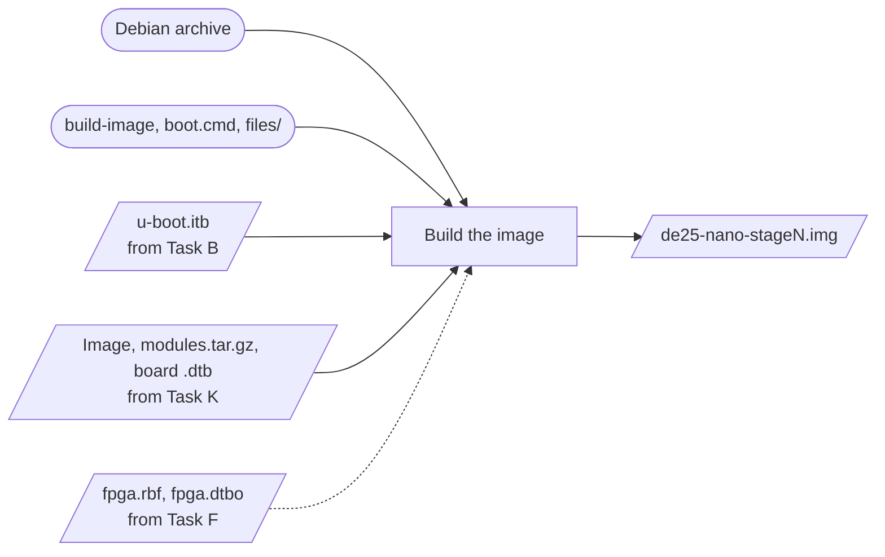

# Task I: SD card image



## What it produces

`out/sdimage/de25-nano-stage1.img` or `out/sdimage/de25-nano-stage2.img`: a complete card
image, 3 GB, to be written to a microSD card ([install-card.md](../install-card.md)).

| Partition | Contents |
|---|---|
| 1, FAT, 64 MB, mounted at `/boot/firmware` | `u-boot.itb`; `boot.scr`, the U-Boot script; for stage 2, `fpga.rbf` |
| 2, ext4, the rest, `/` | Debian 13; `/boot/vmlinuz-<release>`; `/boot/dtbs/<release>/socfpga_agilex5_de25_nano.dtb`; the boot menu `/boot/extlinux/extlinux.conf`; for stage 2, `/boot/dtbo/fpga.dtbo` |

Both partitions are marked bootable, because U-Boot scans only those: partition 1 for the
script, then partition 2 for the menu. Partition 2 grows to fill the card at first boot.

This task owns the layout of the card, so the U-Boot script and the boot menu are here.

- `boot.cmd` (wrapped into `boot.scr` during the build) tells U-Boot the name of the device
  tree file and where to load overlays, and loads `fpga.rbf` if it is on the card.
- The boot menu gives, for the kernel, its own device tree directory (`fdtdir`) and the
  overlay (`fdtoverlays`). In a stage 1 image the `fdtoverlays` line is there but commented
  out.

The image also installs, for stage 2 (`files/`): a udev rule and script that set the fan
curve when the fan controller appears, and a script and unit that set up the HDMI transmitter
at boot. Without the FPGA design they do nothing.

The user is `debian`, with `sudo` without a password. With ssh keys given, ssh accepts keys
only. Without, the password is `debian` and has to be changed at the first login. The network
uses DHCP.

## What it needs first

- Task B: `out/u-boot/u-boot.itb`.
- Task K: `out/kernel/Image`, `modules.tar.gz`, `dtbs/socfpga_agilex5_de25_nano.dtb`.
- For stage 2, Task F: `out/fpga/fpga.rbf` and `out/fpga/fpga.dtbo`.

## Tools to download

Docker. On a host that is not arm64, qemu-user with binfmt for aarch64 (Debian and Ubuntu:
`qemu-user-static` or `qemu-user-binfmt`): the build runs arm64 programs while it puts the
root filesystem together. Check with `ls /proc/sys/fs/binfmt_misc/ | grep aarch64`.

The build runs in a privileged container, which `mmdebstrap` needs to mount `/proc` and
`/dev` inside the new root filesystem.

## Source

Debian packages from the archive, fetched by `mmdebstrap`. Ours: `build.sh` (collects the
other tasks' outputs), `build-image` and `mkimage-inner.sh` (make the image), `boot.cmd`,
`files/`.

## Commands

```
SSH_KEYS=~/.ssh/id_ed25519.pub MAC=02:de:25:00:00:01 sdimage/build.sh stage1
```

or `stage2`. Both settings are optional; the top of `build.sh` lists them all. Give `MAC`: the
board stores no Ethernet address and U-Boot otherwise invents one at every boot, so a DHCP
server hands out a different address each time. Any address with the second hex digit 2, 6,
a or e is a valid locally administered one. Five to ten minutes.

Check the result: the script ends by printing the partition table (both partitions with `*`
in the Boot column) and the image's checksum.

## From stage 1 to stage 2 without a new image

On the running board, after the flash has been written:

```
sudo cp fpga.rbf /boot/firmware/fpga.rbf
sudo mkdir -p /boot/dtbo && sudo cp fpga.dtbo /boot/dtbo/fpga.dtbo
sudo sed -i 's|^\( *\)#fdtoverlays|\1fdtoverlays|' /boot/extlinux/extlinux.conf
sudo reboot
```

To try a changed FPGA design later, replace those two files and reboot. No flash write is
needed as long as the first stage is unchanged.
