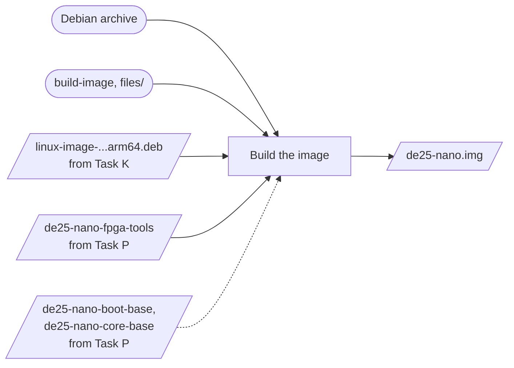

# Task I: SD card image



## What it produces

`out/sdimage/de25-nano.img`: a complete card image, 1 GB (about 115 MB compressed with `xz`),
to be written to a microSD card ([install.md](../install.md)).

It is one image for every board. The boot package and the base core are installed in it
as packages, with their files in `/usr/lib/de25-nano/`, where the boot does not use them, so
a new card boots without a core, which is stage 1. On the board, `sudo de25-fpga select base`
has the flash written with the HPS image the core needs, and copies the core image and its
overlay to where the boot uses them ([install.md](../install.md)).

When Task F has not been built, the script makes `out/sdimage/de25-nano-nofpga.img` instead:
the same image without the boot package and the core.

Partition 1: FAT, 64 MB, mounted at `/boot/firmware`.

- `u-boot.itb` and `boot.scr`, the U-Boot script: the boot package's
- `README.txt`
- once a core is selected: `fpga.rbf`, the core image, and `fpga-core.txt`, its name
- while a flash write is waiting: `write-on-boot.rpd` and `write-on-boot.txt`; after it:
  `saved-<crc32>.rpd`, what the flash held before; if it failed: `write-on-boot-failed.txt`,
  the step it failed in

Partition 2: ext4, the rest of the card, mounted at `/`.

- Debian 13
- the kernel package from Task K, and `/boot/extlinux/extlinux.conf`, the boot menu
- the packages from Task P: `de25-nano-fpga-tools`, `de25-nano-boot-base` (in
  `/usr/lib/de25-nano/boot/base/`) and `de25-nano-core-base` (in
  `/usr/lib/de25-nano/core/base/`)
- once a core is selected: `/boot/dtbo/fpga.dtbo`, its overlay, where the boot menu finds it

Both partitions are marked bootable, because U-Boot scans only those: partition 1 for the
script, then partition 2 for the menu.

This task owns the layout of the card. The pieces that make it boot:

- **`boot.scr`**, from the boot package (`packages/boot/boot.cmd`). It gives U-Boot what its
  own configuration for this board lacks: the name of the device tree file inside a kernel
  package's directory, and the address and size limit for unpacking a compressed kernel. If
  `fpga.rbf` is on the partition and the chip has handed the flash to the SoC, it loads the
  core image, and only when that has succeeded does it set the address overlays are loaded
  to; without that address U-Boot skips the overlay named in the boot menu. If
  `write-on-boot.rpd` is on the partition of a board whose flash is not yet written, it
  writes the flash instead of booting
  ([how-it-works.md](../how-it-works.md#writing-the-flash)).
- **The boot menu** is written by Debian's `u-boot-menu` package (`u-boot-update`), not by
  this task. It makes an entry for every installed kernel, newest first, each with that
  kernel's own device tree directory, and it names every overlay it finds in `/boot/dtbo`. It
  runs again whenever a kernel package is installed or removed. Its settings are in
  `/etc/default/u-boot` (from `files/u-boot.default`): the kernel command line and the menu's
  timeout.

### First boot

Nothing in the image is specific to a person or a board. The first boot of a card
(`files/de25-firstboot`, run once, before the network comes up) does the rest:

- makes new ssh host keys;
- grows partition 2 to fill the card;
- makes up an Ethernet address and keeps it in `/etc/systemd/network/10-emac0.link`. The
  board stores none, and U-Boot would otherwise invent a new one at every boot. The interface
  keeps Debian's usual name for it, `end0`;
- reads two optional files that the user put on the FAT partition beforehand, from any
  computer:

| File on the FAT partition | Effect |
|---|---|
| `hostname` | One line: the board's host name. Without it the name is `de25-nano`. |
| `authorized_keys` | ssh public keys for the user. With it, ssh accepts keys only. |

The user is `debian`, with `sudo` without a password. The image puts `/usr/sbin` on users'
paths in login shells (`files/de25-sbin-path.sh`), which Debian does not, so that `de25-fpga
status` works as it stands. Without an `authorized_keys` file the
password is `debian` and has to be changed at the first login. The network uses DHCP.

## What it needs first

- Task K: `out/kernel/linux-image-*_arm64.deb`.
- Task P: `out/packages/de25-nano-fpga-tools_*.deb`, and for the complete image
  `de25-nano-boot-base_*.deb` and `de25-nano-core-base_*.deb`, which need Tasks B and F.
- Without those two packages, Task B: `out/u-boot/u-boot.itb`.

## Tools to download

Docker. On a host that is not arm64, qemu-user with binfmt for aarch64 (Debian and Ubuntu:
`qemu-user-static` or `qemu-user-binfmt`): the build runs arm64 programs while it puts the
root file system together. Check with `ls /proc/sys/fs/binfmt_misc/ | grep aarch64`.

The build runs in a privileged container, which `mmdebstrap` needs to mount `/proc` and
`/dev` inside the new root file system.

## Source

Debian packages from the archive, fetched by `mmdebstrap`, among them `u-boot-menu`,
`chrony` (the time service, with Debian's default configuration), `linuxptp` and
`mtd-utils` (tools for the board's flash, which Linux has as `/dev/mtd0` in stage 2). From
this directory: `build.sh` (collects the other tasks' outputs), `build-image` and
`mkimage-inner.sh` (make the image), `files/` (the first-boot script and its unit, the boot
menu's settings, and the `README.txt` of the FAT partition), and `qemu-test.sh` with
`qemu/` (a test of the image in QEMU).

## Commands

```
sdimage/build.sh
```

Five to ten minutes. It ends by printing the boot menu that `u-boot-update` wrote, the
partition table (both partitions with `*` in the Boot column) and the image's checksum.

### Testing the image without a board

```
sdimage/qemu-test.sh
```

About five minutes. It boots a copy of the image in QEMU with the kernel from Task K and
checks it from the kernel upwards: the first boot's set-up, that no unit fails, that the
packages are installed and install again on the running system, the man pages, and
`de25-fpga select base` up to the files U-Boot would act on. A good
run ends with `RESULT: all checks passed`.

QEMU has no model of this board's SoC, so nothing before the kernel runs there: not the SPL,
U-Boot, `boot.scr`, the flash or the FPGA, nor any of the board's own hardware. Those need
a board. The script uses `qemu-system-aarch64` and `mtools` if this machine has them, and
a container otherwise.

### Settings

The same things that the first boot sets up can be fixed in the image when it is built, for
an image meant for one board; the top of `build.sh` lists the settings:

```
SSH_KEYS=~/.ssh/id_ed25519.pub HOSTNAME_=myboard MAC=02:de:25:00:00:01 sdimage/build.sh
```

Any Ethernet address with the second hex digit 2, 6, a or e is a valid locally administered
one.

## Changing the card later

A running board is updated with packages, not with a new image. Copy newer `.deb` files to
the board and install them:

```
sudo apt install ./linux-image-*.deb ./de25-nano-*.deb
```

| Package | What happens |
|---|---|
| the kernel | The boot menu is rewritten and the newest kernel becomes its default; the old one stays as the second entry until its package is removed. |
| `de25-nano-fpga-tools` | In effect at once. |
| `de25-nano-core-base`, or another core | If it is the selected core, the new one loads at the next boot. |
| `de25-nano-boot-base` | If the flash holds exactly its HPS image, `u-boot.itb` and `boot.scr` on the card are renewed and take effect at the next boot. If not, nothing changes until `sudo de25-fpga flash-write`, which writes the flash and needs a power cycle. |

`sudo de25-fpga status` says how things stand afterwards.

To add the boot package and a core to a card made from `de25-nano-nofpga.img`, install the
two packages in the same way, then carry on as in [install.md](../install.md).
