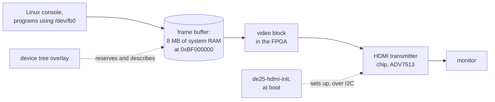

# The system as built

How a board set up from this repository boots and where things are stored, and what the FPGA
design adds in stage 2.

## Booting

### Storage layout

| Storage | Holds | Written |
|---|---|---|
| QSPI flash, on the board | The first stage: the configuration of the SoC (the chip's ARM CPU and its peripherals, which Altera calls the HPS) and the first-stage loader. In stage 1 it has the factory contents, which also hold Terasic's FPGA design. In stage 2 it holds `de25-nano.hps.jic`, and no FPGA design. | Once, over JTAG, for stage 2 |
| SD card, partition 1: FAT, 64 MB, `/boot/firmware` | `u-boot.itb` (U-Boot with TF-A); `boot.scr`, the U-Boot script; `uboot.env`, U-Boot's saved settings, if any have been saved. Stage 2: `fpga.rbf`, the FPGA design. | By the image; later like any file |
| SD card, partition 2: ext4, the rest of the card, `/` | Debian. The kernel `/boot/vmlinuz-<release>` (gzip-compressed), its modules, and its device tree `/usr/lib/linux-image-<release>/intel/socfpga_agilex5_de25_nano.dtb`, all from the kernel package. The boot menu `/boot/extlinux/extlinux.conf`, written by Debian's `u-boot-update` from `/etc/default/u-boot`. Stage 2: the device tree overlay `/boot/dtbo/fpga.dtbo`. | By the image; later by installing packages, and like any file |

### Boot sequence

1. At power-on the chip reads the flash, configures the SoC and runs the first-stage loader
   from the flash. With the factory flash contents it configures the FPGA from the flash first.
2. The loader sets up the memory and loads `u-boot.itb` from partition 1. TF-A starts, then
   U-Boot.
3. U-Boot scans the bootable partitions. On partition 1 it runs `boot.scr`. The script sets
   three things U-Boot's own configuration for this board lacks: the name of the device tree
   file, the address overlays are loaded to, and the address and size limit for unpacking a
   compressed kernel. In stage 2 it also loads `fpga.rbf` into the FPGA.
4. On partition 2 it reads the boot menu. The menu has an entry for each installed kernel; the
   first, the newest, is the default. From the entry U-Boot loads the kernel, the device tree
   from that kernel's own directory and, in stage 2, the overlay, which it applies to the
   device tree.
5. The kernel file is gzip-compressed. U-Boot recognises that, unpacks it to the address
   `boot.scr` gave, moves the result back to the address it loads kernels at, and starts it
   with the device tree.
6. Linux starts with partition 2 as its root. In stage 2 a udev rule sets the fan curve and a
   unit sets up the HDMI transmitter.

The addresses, all in the board's 1 GB of RAM, which starts at 0x80000000:

| Address | Use | Set in |
|---|---|---|
| 0x82000000 | The kernel file is loaded here; the unpacked kernel is moved back here before it is started | U-Boot's configuration (`kernel_addr_r`) |
| 0x86000000 | The device tree | U-Boot's configuration (`fdt_addr_r`) |
| 0x87000000 | Each overlay, while it is applied | `boot.scr` (`fdtoverlay_addr_r`) |
| 0x90000000 | The kernel is unpacked here first | `boot.scr` (`kernel_comp_addr_r`; `kernel_comp_size` limits the compressed kernel to 32 MB) |
| 0xBF000000 | The HDMI frame buffer, 8 MB, in stage 2 | The FPGA design and its overlay |

## Stage 2 features

What the FPGA design adds, once the flash has been written.

### Header pins

The 40-pin header JP1 (GPIO 0) is the one along the edge of the board with the DC jack and the
USB-C sockets; the board has "GPIO_0" printed beside it. Pin 1 is at the DC-jack end, in the
row nearer the middle of the board: its solder pad on the underside is the square one. The
odd-numbered pins are that inner row; the even-numbered pins are the row at the board's edge.
The signals are 3.3 V logic.

| JP1 pin | Signal | Direction | In Linux |
|---|---|---|---|
| 3 | I2C SDA | both | a spare I2C bus |
| 5 | I2C SCL | both | a spare I2C bus |
| 7 | PPS out | output | PTP clock `/dev/ptp0`, periodic output channel 1 |
| 8 | UART0 TX | output | `/dev/ttyS1` |
| 9 | PPS in | input | PTP clock `/dev/ptp0`, external timestamp channel 1 |
| 10 | UART0 RX | input | `/dev/ttyS1` |
| 11 | 5 V (up to 1 A) | | |
| 12 | ground | | |
| 19 | SPI MOSI | output | SPI master 0 |
| 21 | SPI MISO | input | SPI master 0 |
| 23 | SPI SCLK | output | SPI master 0 |
| 24 | SPI SS0 | output | SPI master 0 |
| 29 | 3.3 V (up to 1.5 A) | | |
| 30 | ground | | |

The UART, I2C and SPI signals are on the pins where a Raspberry Pi has them. The power pins
are not where a Raspberry Pi has them: here 5 V is pin 11 and ground is pin 12, so a Raspberry
Pi add-on board cannot be plugged in, and a cable wired for a Raspberry Pi's power pins must
not be used as it is. Pins 1, 2, 4 and 6, which carry power on a Raspberry Pi, are left
unconnected.

The I2C pins have only the FPGA's weak internal pull-ups; a device on that bus may need its
own pull-up resistors.

### HDMI

HDMI output is a scan-out of a frame buffer in system RAM: logic in the FPGA reads the frame
buffer and drives the board's HDMI transmitter. Linux uses it as a `simple-framebuffer`
(`/dev/fb0`); there is no DRM driver. The mode is fixed at 1920x1080, 60 Hz.

| Part | Where it is | What it does |
|---|---|---|
| Frame buffer | 8 MB of system RAM at 0xBF000000, reserved | Holds one frame: 1920x1080 pixels, 32 bits per pixel (`x8r8g8b8`) |
| Video block, `fpga/src/hdmi_scanout.sv` | In the FPGA design (`fpga.rbf`) | Generates the 1080p60 video timing from a 148.5 MHz pixel clock, and reads the frame buffer from system RAM once per frame through the SoC's FPGA-to-SDRAM bridge. It has no registers: it runs as soon as the FPGA design is loaded. |
| HDMI transmitter, ADV7513 | A chip on the board | Converts the FPGA's parallel RGB, sync and clock signals to HDMI |
| `de25-hdmi-init` and its systemd unit | In the Debian image, `/usr/local/sbin` | Configures the transmitter over I2C at every boot; the I2C bus reaches the chip through the FPGA. The output is always enabled and the monitor's EDID is not read. |
| Device tree overlay, `fpga.dtbo` | On the card | Reserves the 8 MB, and describes the frame buffer in a `simple-framebuffer` node |
| Kernel | `CONFIG_FB_SIMPLE`, from the config fragment | Provides `/dev/fb0` from that node |
| Boot menu | `console=tty0` | Puts the text console on the frame buffer |

The frame buffer's address and the resolution are defined in one place, the video block's
source; the overlay's build takes them from there.

### Fan

The fan is driven by a fan controller chip on the board (AMC6821). Linux can only reach it
through the FPGA design, so in stage 1 the fan runs at the chip's power-on speed, which is loud.

| Part | Where it is | What it does |
|---|---|---|
| Fan controller, AMC6821 | A chip on the board, on the same I2C bus as the HDMI transmitter | Drives the fan's PWM input and measures its speed; has its own temperature sensor (the board) and reads the FPGA's temperature diode |
| I2C route | In the FPGA design | Connects that I2C bus to the SoC's I2C0 controller |
| Device tree overlay, `fpga.dtbo` | On the card | Enables I2C0 and declares the controller, with the fan's PWM polarity inverted, as it is on this board |
| Kernel | The `amc6821` hwmon driver (a module in arm64 defconfig) | Provides the controller under `/sys/class/hwmon` |
| `60-de25-fan.rules` and `de25-fan-curve` | In the Debian image: `/etc/udev/rules.d`, `/usr/local/sbin` | The udev rule runs the script when the hwmon device appears; the script sets the fan curve |
| `/etc/default/de25-fan` | In the Debian image | The settings for the curve, read by the script |

The curve is held in the controller, which then follows the FPGA's temperature by itself; no
daemon is involved. The settings in `/etc/default/de25-fan`:

| Setting | Default | Meaning |
|---|---|---|
| `FAN_MIN_PWM` | 90 | The fan drive at its minimum, of 255: about 5,200 rpm |
| `FAN_MIN_TEMP` | 64 | The FPGA temperature, in °C, up to which the fan stays at the minimum |
| `FAN_FULL_TEMP` | 76 | The FPGA temperature at which the fan reaches full speed. The controller supports only certain slopes; with these defaults it settles on 74 °C. |

After changing them, reboot, or apply them at once with
`sudo udevadm trigger --action=add --subsystem-match=hwmon`. With the defaults, on one board
with Linux idle, the FPGA sits near 58 °C and the board sensor near 37 °C.
