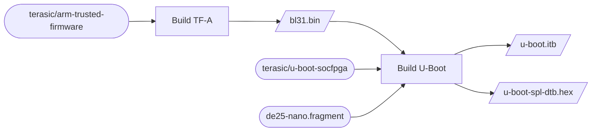

# Task B: U-Boot, with TF-A



## What it produces

| File | What it is | Where it goes |
|---|---|---|
| `out/u-boot/u-boot.itb` | U-Boot, TF-A's `bl31.bin` and U-Boot's own device tree in one file | The FAT partition of the SD card, by Task I. The first-stage loader in the flash loads it. |
| `out/u-boot/u-boot-spl-dtb.hex` | The first-stage loader (SPL) | Into the flash image, by Task F. Not used for stage 1: a factory board already has this loader in its flash. |

## What it needs first

Nothing.

## Tools to download

Docker. `u-boot/Dockerfile` is the build environment Terasic's own guide names: Ubuntu 22.04
with the Arm GNU 11.2 `aarch64-none-linux-gnu` cross-compiler (fetched from developer.arm.com
when the container image is built).

Use that toolchain. A current distribution compiler was tried first and abandoned: TF-A wants
its own toolchain name and the loader came out a different size.

## Source

- TF-A: `https://github.com/terasic/arm-trusted-firmware`, branch `de25-nano-v2.12.0`, commit
  `580dcb5c4e10`, unchanged.
- U-Boot: `https://github.com/terasic/u-boot-socfpga`, branch `de25-nano-v2025.01`, commit
  `d0f8813fd6bf`, unchanged. It is U-Boot 2025.01 with Altera's and Terasic's additions.
- Added here: `de25-nano.fragment`, merged into Terasic's `socfpga_agilex5_de25_nano_defconfig`. It
  sets one option, `CONFIG_OF_LIBFDT_OVERLAY=y`, which Terasic's configuration leaves off.
  Without it U-Boot has neither the `fdt apply` command nor the `fdtoverlays` line of the boot
  menu, and the device tree overlay for the FPGA design cannot be applied.

Why Terasic's U-Boot and not mainline U-Boot: the first-stage loader of a factory board is
built from this source at this commit (the loader built here is the same as Terasic's prebuilt
one apart from the build date), and the U-Boot on the card has to work with the loader in the
flash.

## Commands

```
u-boot/build.sh
```

It clones the two repositories into `work/` (and stops if a branch is no longer at the commit
above), builds TF-A, then U-Boot, which picks up `bl31.bin` through a link in its source
directory. A few minutes.

Check the result:

- `out/u-boot/u-boot.itb` is about 1 MB and `out/u-boot/u-boot-spl-dtb.hex` about 0.7 MB.
- The script itself checks that the option from the fragment is in the final configuration.
- On the board, U-Boot's first line on the serial console shows the build date of this build:
  `U-Boot 2025.01-gd0f8813fd6bf (<date>)`.

## How U-Boot boots the card

Nothing is compiled into U-Boot for this; it is all on the card, and Task I puts it there.
The top-level [README.md](../README.md) has the whole sequence and the memory addresses. In
short:

1. U-Boot's stock boot command scans the partitions marked bootable.
2. On partition 1 (FAT) it finds the script `boot.scr` and runs it. The script names the
   device tree file, gives the address and size limit for unpacking a compressed kernel, and
   loads the FPGA design `fpga.rbf`; if that succeeds it also sets the address overlays are
   loaded to. Then it returns; U-Boot prints `SCRIPT FAILED: continuing...`, which is what it
   prints whenever a script returns.
3. On partition 2 (ext4) it finds the boot menu `/boot/extlinux/extlinux.conf`, which names
   the kernel, the directory with that kernel's device tree, and the overlay. U-Boot applies
   the overlay only if the script set its load address, that is, only if the FPGA design
   loaded.

U-Boot keeps its saved environment in `uboot.env` on the FAT partition. The image has none;
`saveenv` at the U-Boot prompt creates it.
